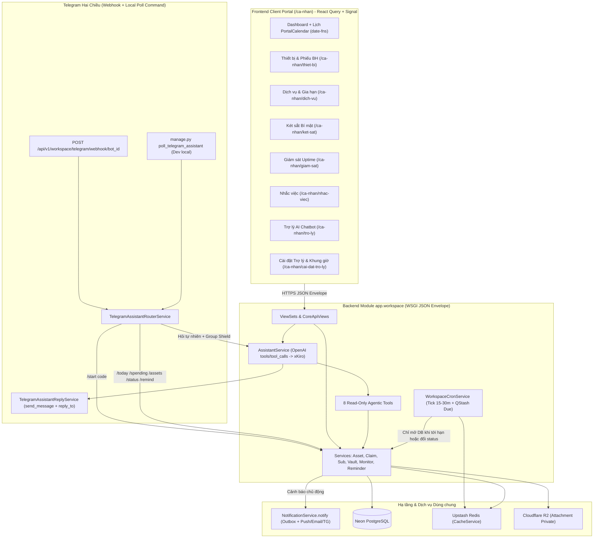
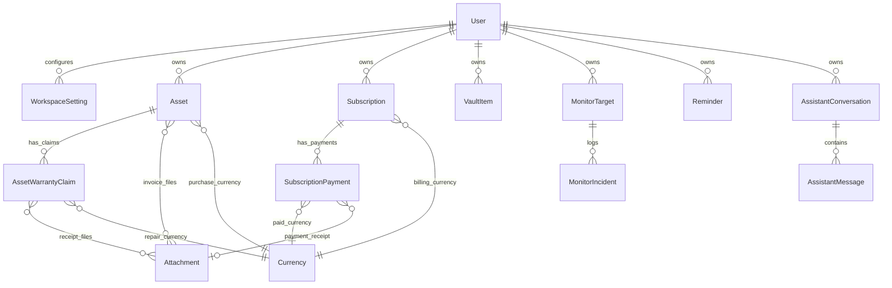
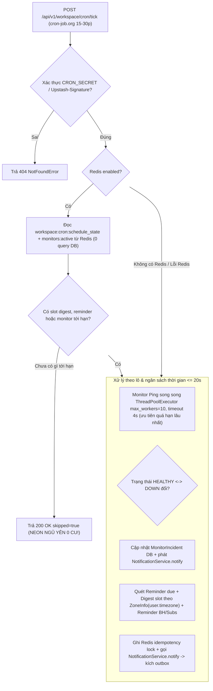

# Kế hoạch Thiết kế & Triển khai Chi tiết: Hệ điều hành Trợ lý Cá nhân & AI OS (`app.workspace` + Client Portal)

Tài liệu đặc tả kỹ thuật hoàn chỉnh (đã qua rà soát 12 trục theo chuẩn repo ToanNX) để triển khai hệ thống trợ lý cá nhân: **100% Client Portal (`/ca-nhan`), không menu nào trong Admin (`/quan-tri`)**, tối ưu ngân sách gói Free, tích hợp Telegram hai chiều (DM & Group Chat), Lịch Dashboard `date-fns`, và Trợ lý AI chuẩn OpenAI (`xKiro` Tool Calling).

---

## Mục lục

1. [Phạm vi, Quyền (`manage_all` vs Portal) & Ràng buộc Hạ tầng](#1-phạm-vi-quyền-manage_all-vs-portal--ràng-buộc-hạ-tầng)
2. [Kiến trúc Tổng thể & Tái sử dụng Common Hiện có](#2-kiến-trúc-tổng-thể--tái-sử-dụng-common-hiện-có)
3. [Thiết kế 11 Models Django ORM Chi tiết (`app.workspace`)](#3-thiết-kế-11-models-django-orm-chi-tiết-appworkspace)
4. [Đặc tả ViewSets, Bộ lọc `Core*InFilter`, Search & Ordering](#4-đặc-tả-viewsets-bộ-lọc-coreinfilter-search--ordering)
5. [Động cơ Cron Động trên Serverless (Redis + QStash + `cron-job.org`, không Celery)](#5-động-cơ-cron-động-trên-serverless-redis--qstash--cron-joborg-không-celery)
6. [Thiết kế Lịch Tương tác Dashboard (`PortalCalendar` với `date-fns`)](#6-thiết-kế-lịch-tương-tác-dashboard-portalcalendar-với-date-fns)
7. [Trí tuệ Nhân tạo Cá nhân (`xKiro` Chuẩn OpenAI + Tool Calling + Guardrails)](#7-trí-tuệ-nhân-tạo-cá-nhân-xkiro-chuẩn-openai--tool-calling--guardrails)
8. [Tương tác Telegram Hai chiều: DM, Chat Nhóm & Privacy Shield](#8-tương-tác-telegram-hai-chiều-dm-chat-nhóm--privacy-shield)
9. [Cấu hình Hệ thống, Biến môi trường, Mã lỗi, Quyền & Rate Limits](#9-cấu-hình-hệ-thống-biến-môi-trường-mã-lỗi-quyền--rate-limits)
10. [Cấu trúc Frontend Portal, Token Màu & Wireframe UI Chi tiết](#10-cấu-trúc-frontend-portal-token-màu--wireframe-ui-chi-tiết)
11. [Kịch bản Kiểm thử Toàn diện (`pytest`, `Vitest`, `Playwright`)](#11-kịch-bản-kiểm-thử-toàn-diện-pytest-vitest-playwright)
12. [Lộ trình Triển khai & Tài liệu Cần cập nhật](#12-lộ-trình-triển-khai--tài-liệu-cần-cập-nhật)

---

## 1. Phạm vi, Quyền (`manage_all` vs Portal) & Ràng buộc Hạ tầng

1. **Giao diện 100% Client Portal (`/ca-nhan`), Admin sạch 100% (`/quan-tri`)**:
   - Toàn bộ route, menu, component, view, service, permission FE nằm trong `frontend/src/modules/portal/`.
   - **Không tạo `navigation.ts` trong `modules/portal/`** và **không đăng ký bất kỳ mục nào vào `ADMIN_MODULE_NAVIGATION`** (`modules/manage-app/constants/admin-navigation.ts`) để bảo đảm Admin không có menu và `tests/unit/module-registry.test.ts` pass.
2. **Phân quyền IAM chuẩn ToanNX (`ADMIN` có toàn quyền `manage_all`, thành viên `MEMBER` chỉ thấy bản ghi của mình)**:
   - Mỗi tài nguyên khai 1 class `XxxPermission(PermissionCatalog)` riêng, có đủ quyền `MANAGE_ALL` (không đưa `MANAGE_ALL` vào `MEMBER`). `ADMIN` (`auto_grant=ALL`) và `WORKSPACE_MANAGER` (`workspace.*`) được quyền xem hết mọi bản ghi ở API; vai trò `WORKSPACE_MEMBER` chỉ xem/sửa/xóa bản ghi của chính mình (bản ghi người khác trả `404`).
   - Tại UI Client Portal (`/ca-nhan`), mọi query danh sách/báo cáo/lịch đều lọc theo `owner = currentUser.user.id` (tương tự `PortalFinance`) để giữ đúng trải nghiệm không gian cá nhân; riêng `VaultItem` dù với `ADMIN` vẫn luôn che bản rõ ở API danh sách (`••••••••xxxx`) và chỉ giải mã qua endpoint `POST /reveal` có rate limit + audit `last_revealed_at`.
3. **Kiến trúc Tác vụ Nền Serverless trên Vercel Hobby (Redis + QStash + `cron-job.org`, KHÔNG dùng Celery)**:
   - Đã kiểm chứng thực tế Vercel (2026) và đối chiếu `docs/reports/2026-11-22-background-jobs-plan.md`:
     - **Vercel Queues + Celery (`broker="vercel://"`, `[[tool.vercel.subscribers]]`)**: chỉ làm task queue serverless, **không dùng Upstash `REDIS_URL` làm broker** và **không có `celery beat`** (Vercel Hobby cron chỉ cho chạy **1 lần/ngày** ở `vercel.json`).
     - **Vercel Daemons** (chạy `celery worker` + `celery beat` + Redis): dù mở Public Beta cho Hobby nhưng giới hạn **Provisioned Memory Hobby = 360 GB-giờ/tháng**; chỉ 1 container 0.5 GB chạy idle 24/7 đã ngốn hết `0.5 × 720 = 360 GB-giờ` (vượt/chặn project ngay khi > 0.5 GB) và `celery beat` polling Redis dễ đốt vượt **500.000 lệnh/tháng** của Upstash Free.
     - **Giải pháp tối ưu hiện có trong repo**: Giữ kiến trúc **Upstash Redis (`CacheService`)** lưu mốc lịch/trạng thái + **Upstash QStash (`QstashClient`)** hẹn giờ từng phút + **`cron-job.org`** làm lưới an toàn trên `@vercel/python` WSGI (0 GB-giờ daemon idle, < 1% lệnh Redis).
4. **Không giới hạn nhân tạo — chỉ giới hạn bởi hạ tầng Gói Free**:
   - Đặt `owner_quota_setting = None` cho **toàn bộ** model trong `app.workspace` (`Asset`, `AssetWarrantyClaim`, `Subscription`, `SubscriptionPayment`, `VaultItem`, `MonitorTarget`, `Reminder`, `AssistantConversation`) giống `app.finance`: **tạo không giới hạn số lượng bản ghi** trong ứng dụng.
   - Các ranh giới duy nhất đến từ **hạn mức thật của nền tảng Free**:
     - **Neon PostgreSQL (1 GB / 100 CU-giờ/tháng)**: `DatabaseUsageService` giám sát mốc 80% dung lượng; Cron tick bắt buộc kiểm **Redis trước** để **0 query DB** khi chưa tới hạn; `cleanup_tasks` tự dọn log cũ > 90/180 ngày.
     - **Cloudflare R2 (10 GB)**: `AttachmentService` kiểm tổng dung lượng hai bucket ở mức 90%.
     - **Vercel Hobby (300s/request, 4 giờ Active CPU/tháng)**: `MonitorTarget` không giới hạn số URL tạo, thay bằng xử lý theo lô + ngân sách thời gian (`ThreadPoolExecutor(max_workers=10)`, timeout `4s`/URL, tổng budget `<= 20s`/lượt ưu tiên URL quá hạn ping lâu nhất trước).
     - **Upstash Redis (500k lệnh/tháng) & QStash (1.000 tin/ngày) & xKiro API**: có cơ chế fallback sạch sang PostgreSQL / `cron-job.org` / lệnh Slash 0-token khi bất kỳ dịch vụ ngoài nào chạm hạn mức ngày/tháng.
5. **Không thêm dependency mới**:
   - BE: Tận dụng `requests>=2.34.2`, `cryptography`, `SecretCipher`, `SafeHttpClient`, stdlib `calendar.monthrange` + `zoneinfo.ZoneInfo` (không dùng `python-dateutil`/`relativedelta`, không dùng `openai` SDK nếu không cần).
   - FE: Tận dụng `date-fns ^4.4.0` (đã có trong `frontend/package.json`) và toàn bộ common components trong `@/shares/components/common/`.

---

## 2. Kiến trúc Tổng thể & Tái sử dụng Common Hiện có

### 2.1. Thành phần dùng lại & mở rộng từ Core/System/Utilities (trước khi viết mới)

| Thành phần sẵn có | Đường dẫn nguồn | Cách sử dụng / Mở rộng trong `app.workspace` |
| --- | --- | --- |
| `CoreModel`, `JournalTracker`, `CoreRepository`, `CoreCrudService` | `app/core/` | Lớp nền chuẩn cho toàn bộ CRUD, soft-delete, audit, owner scope, journal. |
| `CoreModelViewSet`, `CoreApiView`, `@validate_request`, `@rate_limit` | `app/core/` | Lớp View chuẩn + Swagger envelope `CoreAutoSchema`. |
| `SecretCipher` | `app/core/security/secret_cipher.py` | Mã hóa `VaultItem.secret_encrypted` với purpose `"workspace.vault.secret"`. |
| `SafeHttpClient`, `validate_url_safety`, `PinnedHttpAdapter` | `app/utilities/utils/safe_http_client.py` → chuyển lên **`app/core/utils/`** | Chuyển sang `app/core/utils/` và thêm method `probe(url, method, timeout)` trả `(status_code, latency_ms)` để chống SSRF 7 lớp cho `MonitorTarget` (cập nhật `docs/common-catalog.md`). |
| `CacheService` | `app/core/cache/cache_service.py` | Lưu cache lịch cron, trạng thái ping Monitor tạm, lock idempotency, đếm token AI/ngày (`TTL`, có fallback nếu thiếu `REDIS_URL`). |
| `NotificationService.notify` | `app/system/services/notification_service.py` | **Cổng duy nhất** phát mọi cảnh báo chủ động (Daily Digest, Gia hạn, Bảo hành, Reminder, Monitor DOWN/RECOVERED). |
| `QstashClient` | `app/system/services/qstash_client.py` | Hẹn trễ tới từng phút (`delay_seconds`, max 7 ngày) cho `Reminder` và khung giờ `WorkspaceSetting`. |
| `TelegramBot`, `TelegramChat`, `TelegramClient`, `TelegramChatService` | `app/system/` | Dùng chung bot + nhóm đã đăng ký ở Hồ sơ. Bổ sung optional `reply_to_message_id` vào `TelegramClient.send_message` để trả lời trong Group Chat. |
| `Attachment` (`private`) + `AttachmentService` | `app/system/` | Lưu hóa đơn mua máy, thẻ bảo hành, biên nhận sửa chữa, biên lai gia hạn qua `visibility="private"`. |
| `Currency`, `ExchangeRate` | `app/system/` | Tham chiếu tiền tệ và gợi ý tỷ giá mặc định tại ngày mua/thanh toán. |
| `FinanceReportService.summary` | `app/finance/services/finance_report_service.py` | AI Tool `get_finance_income_summary` gọi trực tiếp `summary(actor, year, month)`. |
| `PageService`, `NovelService` | `app/utilities/`, `app/novel/` | Bổ sung method public `list_stale_for(actor, cutoff)` để AI Tool `get_stale_projects` gọi đúng lớp Service. |

### 2.2. Sơ đồ Luồng Tổng thể



---

## 3. Thiết kế 11 Models Django ORM Chi tiết (`app.workspace`)

Tất cả **11 models** nằm trong `backend/app/workspace/models/` (mỗi model + `TextChoices` của chính model đó đúng 1 file snake_case). Mọi model nghiệp vụ đặt `JournalTracker` trước `CoreModel` (trừ `MonitorIncident` và `AssistantMessage` dùng `CoreModel` thuần để tránh phình bảng `JournalEntry` khi lưu hội thoại/log). Mọi index owner đều đặt `condition=Q(deleted_at__isnull=True)`.



### 3.1. `Asset` — Thiết bị, Nơi mua & Hạn bảo hành (`models/asset.py`)
Kế thừa `(JournalTracker, CoreModel)`:
- **Định danh thiết bị**:
  - `owner` (`FK User, CASCADE`), `name` (`CharField(200)`), `brand` (`CharField(100)`), `model_code` (`CharField(100)`).
  - `category` (`TextChoices`: `LAPTOP`, `PHONE`, `TABLET`, `MONITOR`, `PERIPHERAL`, `AUDIO`, `NETWORK`, `CAMERA`, `OTHER`).
  - `serial_number` (`CharField(100)`), `imei` (`CharField(50)`), `specs` (`JSONField(default=dict)`).
  - `status` (`TextChoices`: `IN_USE`, `BACKUP`, `IN_WARRANTY`, `IN_REPAIR`, `SOLD`, `BROKEN`).
- **Nơi mua & Giá mua lịch sử**:
  - `purchase_date` (`DateField()`), `purchase_price` (`DecimalField(18, 2)`), `currency` (`FK system.Currency, PROTECT`).
  - `exchange_rate` (`DecimalField(18, 6, default=1)`): Chụp tỷ giá tại ngày mua (gợi ý từ `system.ExchangeRate`, sửa được).
  - `purchase_price_vnd` (`DecimalField(18, 0)`): `round(purchase_price * exchange_rate)` dùng thống kê tài sản & AI chi tiêu.
  - `purchase_store` (`CharField(150)`): Tên nơi mua (*Apple Store VN*, *CellphoneS*, *GearVN*).
  - `purchase_channel` (`TextChoices`: `OFFICIAL_STORE`, `RETAILER`, `ECOMMERCE`, `SECOND_HAND`, `COMPANY`, `GIFT`).
  - `purchase_branch_address` (`CharField(255, blank=True)`), `purchase_order_code` (`CharField(100, blank=True)`), `purchase_order_url` (`URLField(500, blank=True)`), `store_warranty_contact` (`CharField(150, blank=True)`).
- **Thời gian & Chính sách Bảo hành**:
  - `warranty_type` (`TextChoices`: `MANUFACTURER`, `STORE`, `EXTENDED`, `NONE`).
  - `warranty_months` (`PositiveIntegerField(null=True, blank=True)`).
  - `warranty_start_date` (`DateField(null=True, blank=True)`, mặc định = `purchase_date`).
  - `warranty_end_date` (`DateField(null=True, blank=True, db_index=True)`): Nếu nhập `warranty_months` mà bỏ trống `warranty_end_date`, `AssetService` tự tính bằng helper thuần Python `add_months_clamped(warranty_start_date, warranty_months, anchor_day=warranty_start_date.day)`.
  - `warranty_provider` (`CharField(150, blank=True)`), `warranty_note` (`TextField(blank=True)`).
- **Hóa đơn & Ghi chú**:
  - `invoice_attachments` (`M2M("system.Attachment", blank=True)` — hóa đơn VAT, phiếu mua, thẻ BH gốc, `visibility="private"`).
  - `notes` (`TextField(blank=True)`).
- **Indexes & Annotations**:
  - Partial indexes: `(owner, warranty_end_date)` và `(owner, status)` với `condition=Q(deleted_at__isnull=True)`.
  - `AssetRepository.get_queryset()` annotate 1 query (0 N+1):
    - `warranty_claim_count` (số phiếu `claim_type=WARRANTY`, `deleted_at__isnull=True`)
    - `repair_count` (số phiếu `claim_type=PAID_REPAIR`, `deleted_at__isnull=True`)
    - `total_claim_count` (tổng số lần bảo hành + sửa chữa + bảo dưỡng)
    - `open_claim_count` (số phiếu chưa đóng `SUBMITTED` / `INSPECTING` / `WAITING_PARTS`)
    - `total_service_cost_vnd` (tổng chi phí sửa chữa từ các phiếu chưa xóa mềm)
    - `last_claim_date` (ngày gửi bảo hành/sửa gần nhất)

### 3.2. `AssetWarrantyClaim` — Phiếu Bảo hành & Sửa chữa (`models/asset_warranty_claim.py`)
Kế thừa `(JournalTracker, CoreModel)`:
- `owner` (`FK User, CASCADE`), `asset` (`FK Asset, CASCADE, related_name="warranty_claims"`).
- `claim_code` (`CharField(32)`): Tự sinh dạng `BH-YYYYMM-NNN` nếu để trống; `UniqueConstraint(fields=["owner", "claim_code"], condition=Q(deleted_at__isnull=True), name="uq_workspace_claim_owner_code")`.
- `claim_type` (`TextChoices`: `WARRANTY`, `PAID_REPAIR`, `MAINTENANCE`).
- `status` (`TextChoices`: `SUBMITTED`, `INSPECTING`, `WAITING_PARTS`, `COMPLETED`, `REJECTED`, `CANCELLED`).
- `submitted_date` (`DateField()`), `estimated_return_date` (`DateField(null=True, blank=True)`), `returned_date` (`DateField(null=True, blank=True)`).
- `service_center` (`CharField(200)`), `service_center_address` (`CharField(255, blank=True)`), `service_center_contact` (`CharField(150, blank=True)`), `external_ticket_code` (`CharField(100, blank=True)`).
- `issue_description` (`TextField()`), `resolution_notes` (`TextField(blank=True)`).
- `is_covered_by_warranty` (`BooleanField(default=True)`).
- `cost` (`DecimalField(18, 2, default=0)`), `currency` (`FK system.Currency, PROTECT`), `exchange_rate` (`DecimalField(18, 6, default=1)`), `cost_vnd` (`DecimalField(18, 0, default=0)`).
- `part_warranty_months` (`PositiveIntegerField(null=True, blank=True)`), `part_warranty_end_date` (`DateField(null=True, blank=True)` — tự tính nếu có `returned_date` + `part_warranty_months`).
- `attachments` (`M2M("system.Attachment", blank=True)` — biên nhận, ảnh lỗi trước/sau, hóa đơn phí sửa, `visibility="private"`).
- **Đồng bộ trạng thái tự động trong `AssetWarrantyClaimService`**: Tạo/mở phiếu cho máy đang `IN_USE` → máy tự sang `IN_WARRANTY`/`IN_REPAIR`; đóng phiếu `COMPLETED` (và không còn phiếu mở khác) → máy tự về `IN_USE`.

### 3.3. `Subscription` & `SubscriptionPayment` (`models/subscription.py`, `models/subscription_payment.py`)
- **`Subscription`** `(JournalTracker, CoreModel)`:
  - `owner` (`FK User`), `name` (`CharField(200)`), `provider` (`CharField(150)`), `category` (`DOMAIN`, `HOSTING_VPS`, `SAAS_TOOL`, `ENTERTAINMENT`, `TELECOM`, `OTHER`).
  - `billing_cycle` (`WEEKLY`, `MONTHLY`, `QUARTERLY`, `SEMI_ANNUAL`, `YEARLY`, `CUSTOM_DAYS`), `custom_cycle_days` (`PositiveIntegerField(null=True)`).
  - `anchor_day` (`PositiveSmallIntegerField(default=1)`): Ngày gốc trong tháng (1–31) để khi gia hạn qua tháng 2 (28/29 ngày) rồi sang tháng 3 vẫn quay về đúng ngày 31 thay vì bị trượt vĩnh viễn!
  - `amount` (`DecimalField(18, 2)`), `currency` (`FK Currency`), `exchange_rate` (`DecimalField(18, 6, default=1)`), `amount_vnd` (`DecimalField(18, 0)`).
  - `renew_date` (`DateField(db_index=True)`), `auto_renew` (`BooleanField(default=False)`), `payment_method` (`CharField(100)`), `manage_url` (`URLField(500)`).
  - `reminder_days_before` (`JSONField(default=list)`, mặc định `[7, 3, 1]`), `is_active` (`BooleanField(default=True)`), `notes` (`TextField`).
- **`SubscriptionPayment`** `(JournalTracker, CoreModel)`:
  - `owner` (`FK User`), `subscription` (`FK Subscription, CASCADE, related_name="payments"`).
  - `paid_on` (`DateField(db_index=True)`), `period_from` (`DateField()`), `period_to` (`DateField()`).
  - `amount` (`DecimalField(18, 2)`), `currency` (`FK Currency`), `exchange_rate` (`DecimalField(18, 6, default=1)`), `amount_vnd` (`DecimalField(18, 0)`).
  - `payment_method` (`CharField(100)`), `receipt_attachment` (`FK Attachment, SET_NULL, null=True`, `private`), `note` (`TextField`).
  - Endpoint `POST /api/v1/workspace/subscriptions/{id}/renew` ghi nhận 1 `SubscriptionPayment` và tịnh tiến `renew_date` theo `anchor_day`.

### 3.4. `VaultItem` — Két sắt Bí mật (`models/vault_item.py`)
Kế thừa `(JournalTracker, CoreModel)`, `journal_masked_fields = ("secret_encrypted",)`:
- `owner` (`FK User`), `title` (`CharField(200)`), `category` (`SERVER`, `API_KEY`, `ACCOUNT`, `SNIPPET`, `ENV_CONFIG`, `OTHER`).
- `username` (`CharField(200)`), `secret_encrypted` (`TextField()` — mã hóa `SecretCipher` purpose `"workspace.vault.secret"`), `secret_last4` (`CharField(4)`).
- `url` (`CharField(500)`), `notes` (`TextField`), `tags` (`JSONField(default=list)`), `last_revealed_at` (`DateTimeField(null=True)`).

### 3.5. `MonitorTarget` & `MonitorIncident` (`models/monitor_target.py`, `models/monitor_incident.py`)
- **`MonitorTarget`** `(JournalTracker, CoreModel)`:
  - `owner` (`FK User`), `name` (`CharField(200)`), `url` (`URLField(500)` — validate qua `SafeHttpClient` chặn SSRF), `method` (`GET`/`HEAD`).
  - `expected_status` (`PositiveIntegerField(default=200)`), `timeout_seconds` (`PositiveSmallIntegerField(default=4)`, max 8), `check_interval_minutes` (`PositiveIntegerField(default=30)`, min 15).
  - `is_active` (`BooleanField(default=True)`), `last_status` (`HEALTHY`, `DEGRADED`, `DOWN`, `UNKNOWN`), `last_status_code` (`PositiveIntegerField(null=True)`), `last_latency_ms` (`PositiveIntegerField(null=True)`), `last_checked_at` (`DateTimeField(null=True)`), `consecutive_failures` (`PositiveSmallIntegerField(default=0)`).
- **`MonitorIncident`** `(CoreModel)`:
  - `owner` (`FK User`), `target` (`FK MonitorTarget, CASCADE, related_name="incidents"`).
  - `started_at` (`DateTimeField(db_index=True)`), `resolved_at` (`DateTimeField(null=True)`), `status_code` (`IntegerField(null=True)`), `error_message` (`TextField(blank=True)`), `duration_seconds` (`PositiveIntegerField(null=True)`).

### 3.6. `Reminder` — Nhắc việc Cá nhân (`models/reminder.py`)
Kế thừa `(JournalTracker, CoreModel)`:
- `owner` (`FK User`), `title` (`CharField(255)`), `description` (`TextField(blank=True)`).
- `due_date` (`DateField(db_index=True)`), `due_time` (`TimeField(null=True)`), `notify_minutes_before` (`PositiveSmallIntegerField(default=0)`).
- `priority` (`LOW`, `MEDIUM`, `HIGH`, `URGENT`), `is_completed` (`BooleanField(default=False, db_index=True)`), `completed_at` (`DateTimeField(null=True)`).
- `recurrence` (`NONE`, `DAILY`, `WEEKLY`, `MONTHLY`, `YEARLY`), `anchor_day` (`PositiveSmallIntegerField(null=True)`), `tags` (`JSONField(default=list)`).

### 3.7. `WorkspaceSetting` — Cấu hình Cron Động & Telegram (`models/workspace_setting.py`)
Kế thừa `(JournalTracker, CoreModel)`:
- **`owner` (`models.ForeignKey(User, on_delete=models.CASCADE, related_name="workspace_settings")`)** + `UniqueConstraint(fields=["owner"], condition=Q(deleted_at__isnull=True), name="uq_workspace_setting_owner")` (tránh bẫy `OneToOneField` với soft-delete của `CoreModel`).
- `timezone` (`CharField(64, default="Asia/Ho_Chi_Minh")`), `daily_digest_enabled` (`BooleanField(default=True)`).
- `digest_time_slots` (`JSONField(default=list)` — VD `["08:00", "20:30"]`, không giới hạn cứng số khung giờ, chỉ validate định dạng `HH:MM` và khử trùng lặp).
- `warranty_alert_days` (`JSONField(default=list)`, mặc định `[30, 7, 1]`), `subscription_default_alert_days` (`JSONField(default=list)`, mặc định `[7, 3, 1]`).
- `telegram_ai_enabled` (`BooleanField(default=False)`), `telegram_owner_user_id` (`BigIntegerField(null=True, blank=True)`), `telegram_allowed_chat_ids` (`JSONField(default=list)` — lưu UUID hoặc `chat_id` của các `system.TelegramChat` đang active), `telegram_group_require_mention` (`BooleanField(default=True)`).
- `ai_daily_token_limit` (`PositiveIntegerField(null=True, blank=True, default=None)` — mặc định không khóa nhân tạo từ app, chạy theo quota thật của `xKiro` hoặc theo ngưỡng tự đặt của user nếu có).

### 3.8. `AssistantConversation` & `AssistantMessage` (`models/assistant_conversation.py`, `models/assistant_message.py`)
- **`AssistantConversation`** `(JournalTracker, CoreModel)`:
  - `owner` (`FK User`), `channel` (`WEB`, `TELEGRAM_DM`, `TELEGRAM_GROUP`), `external_chat_id` (`CharField(64, db_index=True)`), `title` (`CharField(200)`), `last_message_at` (`DateTimeField(null=True)`).
- **`AssistantMessage`** `(CoreModel)`:
  - `conversation` (`FK AssistantConversation, CASCADE, related_name="messages"`).
  - `role` (`USER`, `ASSISTANT`, `TOOL`, `SYSTEM`), `sender_telegram_id` (`BigIntegerField(null=True)`), `sender_name` (`CharField(150, blank=True)`).
  - `content` (`TextField()`), `tool_calls` (`JSONField(null=True)`), `tool_call_id` (`CharField(100, blank=True)`), `tokens_used` (`PositiveIntegerField(default=0)`), **`contains_private_data` (`BooleanField(default=False)`)**, `is_error` (`BooleanField(default=False)`).

---

## 4. Đặc tả ViewSets, Bộ lọc `Core*InFilter`, Search & Ordering

| Resource / ViewSet | `filterset_class` (`Core*InFilter`) | `search_fields` | `ordering_fields` / Mặc định | Bulk / Actions riêng |
| --- | --- | --- | --- | --- |
| `AssetViewSet` | `category`, `status`, `warranty_type`, `purchase_channel`, `owner` (`Core*InFilter`) | `name`, `brand`, `model_code`, `serial_number`, `imei`, `purchase_store`, `purchase_order_code` | `purchase_date`, `warranty_end_date`, `purchase_price_vnd`, `created_at` (`-created_at`) | `bulk_delete_enabled = True`, `history_enabled = True` |
| `AssetWarrantyClaimViewSet` (`/api/v1/workspace/warranty-claims?asset=<uuid>`) | `asset`, `claim_type`, `status`, `is_covered_by_warranty`, `owner` | `claim_code`, `external_ticket_code`, `service_center`, `issue_description`, `asset__name` | `submitted_date`, `estimated_return_date`, `returned_date`, `cost_vnd`, `created_at` (`-submitted_date`) | `bulk_delete_enabled = True`, `history_enabled = True` |
| `SubscriptionViewSet` | `category`, `billing_cycle`, `is_active`, `auto_renew`, `owner` | `name`, `provider`, `payment_method` | `renew_date`, `amount_vnd`, `created_at` (`renew_date`) | `bulk_delete_enabled = True`, `bulk_update_serializer_class`, custom `@action renew`, `history_enabled = True` |
| `SubscriptionPaymentViewSet` *(Read + Delete)* | `subscription`, `currency`, `owner` | `subscription__name`, `payment_method`, `note` | `paid_on`, `amount_vnd`, `created_at` (`-paid_on`) | `bulk_delete_enabled = True` |
| `VaultItemViewSet` | `category`, `owner` | `title`, `username`, `url`, `notes` | `title`, `last_revealed_at`, `created_at` (`-created_at`) | `bulk_delete_enabled = True`, custom `@action reveal` (`POST`, rate-limited), `history_enabled = True` |
| `MonitorTargetViewSet` | `last_status`, `is_active`, `method`, `owner` | `name`, `url` | `last_checked_at`, `last_latency_ms`, `created_at` (`-created_at`) | `bulk_delete_enabled = True`, `bulk_update_serializer_class`, custom `@action ping` (`POST`, rate-limited), `history_enabled = True` |
| `ReminderViewSet` | `priority`, `is_completed`, `recurrence`, `owner` (+ `due_from`, `due_to`) | `title`, `description` | `due_date`, `priority`, `created_at` (`due_date`) | `bulk_delete_enabled = True`, `bulk_update_serializer_class`, `history_enabled = True` |

---

## 5. Động cơ Cron Động trên Serverless (Redis + QStash + `cron-job.org`, không Celery)

### 5.1. Đánh giá phương án nền trên Vercel (So sánh Celery vs Redis + QStash + `cron-job.org`)

| Phương án | Hỗ trợ trên Vercel | Dùng Upstash Redis hiện có? | Phù hợp Gói Free (Hobby + Upstash + Neon)? |
| --- | --- | --- | --- |
| **Celery + Vercel Queues** (`broker="vercel://"`) | Có (`[[tool.vercel.subscribers]]`) | **Không** (dùng `vercel://` Queue, không dùng Redis; không có `celery beat` cron) | Chỉ hợp task queue; Vercel Hobby cron vẫn khóa **1 lần/ngày** → không chạy được cron nhiều khung giờ hay Monitor định kỳ. |
| **Celery + Redis trên Vercel Daemons** | Có (Docker daemon Public Beta) | Có | ❌ **Không khả thi Hobby**: 1 daemon 0.5 GB chạy 24/7 hết `360 GB-giờ` = 100% hạn mức Hobby; polling Redis liên tục dễ vượt 500k lệnh/tháng. |
| **Upstash Redis + QStash + `cron-job.org`** *(Chọn)* | Thuần `@vercel/python` WSGI | **Có (`CacheService`)** | ✅ **Tối ưu Free-tier**: 0 GB-giờ daemon idle, < 1% lệnh Redis, Neon ngủ khi chưa tới hạn, QStash hẹn chính xác theo phút. |

### 5.2. Cơ chế phối hợp Redis + QStash + `cron-job.org`
- Hệ thống hiện tại (`app/system/`) chạy WSGI (`config/wsgi.py`) với `CacheService` (Upstash Redis) và `QstashClient`:
  1. **Upstash Redis (`CacheService`)**: giữ mốc lịch kế tiếp (`workspace:cron:next_tick`), danh sách cache target Monitor (`workspace:monitors:active`), trạng thái ping gần nhất (`workspace:monitor_state:{id}`), và khóa chống gửi trùng (`workspace:digest_sent:{owner_id}:{YYYY-MM-DD}:{slot}`, TTL 86.400s).
  2. **Upstash QStash (`QstashClient.publish(..., delay_seconds=...)`)**: đặt lịch bắn chính xác tới từng phút cho `digest_time_slots` và `Reminder.due_time` (trong cửa sổ 7 ngày) tới `POST /api/v1/workspace/cron/dispatch-due` (chữ ký `Upstash-Signature`).
  3. **`cron-job.org` (miễn phí, mỗi 15 hoặc 30 phút)**: gọi `POST /api/v1/workspace/cron/tick` kèm `Authorization: Bearer <CRON_SECRET>` làm lưới an toàn & chạy ping `MonitorTarget`.

### 5.3. Quy trình zero-DB wakeup & Fallback an toàn khi mất Redis



### 5.4. Dự toán Ngân sách Free-tier bổ sung (`docs/architecture/infrastructure.md`)

| Tài nguyên | Mức tiêu thụ ước tính của `app.workspace` | Giới hạn Free & Xử lý chạm trần |
| --- | --- | --- |
| **Neon CU-giờ & Dung lượng** | Ping monitor cache Redis chỉ chạm DB khi đổi trạng thái hoặc đồng bộ 6h/lần (~4 lần/ngày × 5p × 30 ngày ≈ **10 CU-giờ** khi 0.25 CU) + sử dụng Portal (~5 CU-giờ). Không giới hạn số dòng tạo miễn tổng DB dưới **1 GB** (theo dõi qua `DatabaseUsageService` ở 80%). | 100 CU-giờ/tháng & 1 GB/project (`cleanup_tasks` dọn log > 90/180 ngày). |
| **Vercel Active CPU & Duration** | Cron tick bỏ qua sớm: ~20ms; mỗi lượt ping theo lô song song `<= 20s` (~1–2s Active CPU thực cho 5–15 URL × 48 lần/ngày × 30 ngày ≈ **~0.8–1.5 giờ/tháng**). | 4 giờ Active CPU/tháng & 300s/request (tự dừng batch ở `20s`, phần còn lại chạy ở tick sau). |
| **Upstash Redis** | Đọc 2 key/tick × 48 lần/ngày + chat counters (~4.000 lệnh/tháng). | 500.000 lệnh/tháng (< 1%, lỗi/hết lệnh tự fallback DB). |
| **Upstash QStash** | Hẹn giờ Reminder + Digest (~5–15 tin/ngày). | 1.000 tin/ngày (hết hạn mức thì `cron-job.org` gánh tiếp). |
| **Cloudflare R2** | Hóa đơn thiết bị, phiếu BH, biên lai (`private`). | 10 GB (`AttachmentService` cảnh báo 90% qua `ATTACHMENT_MAX_TOTAL_STORAGE_BYTES`). |

---

## 6. Thiết kế Lịch Tương tác Dashboard (`PortalCalendar` với `date-fns`)

- **Thư viện**: Sử dụng **`date-fns ^4.4.0`** (`startOfMonth`, `endOfMonth`, `startOfWeek`, `endOfWeek`, `eachDayOfInterval`, `format`, `isSameMonth`, `isSameDay`, `isToday`, `addMonths`, `subMonths`, `parseISO`) cùng locale `vi` / `enUS` từ `date-fns/locale`.
- **Xử lý múi giờ**: Backend chuẩn hóa mọi mốc `"hôm nay"` và lọc `from..to` theo `ZoneInfo(setting.timezone)`. API `GET /api/v1/workspace/calendar?from=YYYY-MM-DD&to=YYYY-MM-DD&types=...` trả danh sách sự kiện 5 nguồn:
  1. `subscription` (ngày `renew_date`) — token `--color-warning` / `--color-warning-bg`
  2. `reminder` (ngày `due_date`) — token `primary-light` / `primary`
  3. `asset_warranty` (ngày `warranty_end_date` của `Asset`) — token `--color-info` / `--color-info-bg` *(khai mới vào `globals.css`)*
  4. `warranty_claim` (ngày `estimated_return_date` của phiếu đang mở hoặc `part_warranty_end_date`) — token `--color-success` / `--color-success-bg`
  5. `monitor_incident` (ngày phát sinh `started_at`) — token `destructive`
- **Tương tác**:
  - Đồng bộ `?month=YYYY-MM&date=YYYY-MM-DD` vào URL qua `window.history.replaceState`.
  - Bấm vào ngày bất kỳ: Panel/Sheet chi tiết ngày hiển thị việc của ngày đó, cho phép **tick hoàn thành Reminder trực tiếp** (mutation `PATCH /reminders/{id}`) và mở `FormPage` hoặc tạo nhanh Reminder trong `FormDialog` (phù hợp rule tạo nhanh tài nguyên phụ).

---

## 7. Trí tuệ Nhân tạo Cá nhân (`xKiro` Chuẩn OpenAI + Tool Calling + Guardrails)

### 7.1. Kiến trúc JSON Request-Response Chuẩn OpenAI trên WSGI
- Dùng HTTP POST (`requests`, timeout 10s/vòng) tới `{XKIRO_API_BASE}/chat/completions` gửi mảng `messages` + `tools` (JSON Schema chuẩn OpenAI) + `tool_choice="auto"`.
- API Backend `POST /api/v1/workspace/assistant/chat` chạy qua `CoreApiView` + `@validate_request` + `CoreResponse(AssistantChatResponseSerializer)`, vòng lặp tối đa **`MAX_TOOL_ROUNDS = 3`** (tổng ngân sách `< 22s`), trả envelope `{success, data: {conversation_id, user_message, assistant_message, tools_used, tokens_used, is_fallback}}`. Không dùng SSE streaming trên WSGI.
- Context giữ tối đa **10 tin nhắn gần nhất**, loại bỏ message `TOOL` thô cũ hơn 2 lượt trước để tiết kiệm token.

### 7.2. 8 Agentic Read-Only Tools (+1 Quick Reminder cho chính chủ)

| Tool | Dịch vụ Backend gọi | Câu hỏi đáp ứng & Ghi chú |
| --- | --- | --- |
| `get_spending_summary` | `WorkspaceSpendingService.summary(actor, month, year)` | *"Tháng này tôi đã chi bao nhiêu tiền?"* → Cộng `SubscriptionPayment.amount_vnd` + `Asset.purchase_price_vnd` + `AssetWarrantyClaim.cost_vnd` + dự kiến `Subscription` chưa đóng trong tháng. |
| `get_finance_income_summary` | `FinanceReportService.summary(actor, year, month)` | *"Tháng này kiếm bao nhiêu từ affiliate?"* → Dùng thẳng method `summary()` có sẵn của `app.finance`, lọc theo tên nền tảng. |
| `get_upcoming_subscriptions` | `SubscriptionService.get_upcoming(actor, days_ahead)` | *"Những dịch vụ nào sắp hết hạn?"* → Tên, nhà cung cấp, ngày hết, `auto_renew`, số tiền VNĐ. |
| `get_pending_reminders` | `ReminderService.get_pending(actor, scope)` | *"Hôm nay còn công việc gì chưa hoàn thành?"* → Dựa trên `ZoneInfo(user_tz)`. |
| `get_assets_and_warranty` | `AssetService.search_with_warranty_summary(actor, query, status)` | *"MacBook mua ở đâu, còn BH bao lâu, bảo hành mấy lần rồi?"* → Trả về nơi mua, mã đơn, ngày hết BH, `warranty_claim_count`, `repair_count`, phiếu BH gần nhất. |
| `get_stale_projects` | `PageService.list_stale_for(actor, cutoff)` & `NovelService.list_stale_for(actor, cutoff)` | *"Dự án nào lâu rồi chưa cập nhật?"* → Gọi method public mới trên 2 service, không chạm repo chéo module. |
| `get_monitor_health` | `MonitorService.get_realtime_status(actor)` | *"Các trang web còn sống không?"* → Gộp trạng thái Redis cache + `MonitorIncident` gần nhất. |
| `create_quick_reminder` | `ReminderService.create(...)` *(chỉ khi `is_owner=True`)* | *"Nhắc tôi mai 9h đóng tiền mạng"* → Parse `due_date`/`due_time` và tạo `Reminder` kèm đặt QStash. |

### 7.3. Guardrails, Câu trả lời Từ chối & Hết Token

1. **Không bao giờ cấp Tool giải mã `VaultItem` cho LLM**: Ngay cả trên Web Chat hay Telegram, AI không có tool đọc plaintext `secret_encrypted` (chống prompt injection làm lộ mật khẩu ra lịch sử `AssistantMessage`). Người dùng xem Két sắt trực tiếp qua UI Portal `POST /vault/{id}/reveal`.
2. **Cô lập Group Chat (`TELEGRAM_GROUP`)**:
   - Nếu `sender_telegram_id != setting.telegram_owner_user_id`: Backend truyền **`tools = []`** (chỉ giữ kiến thức chung, không có tool đọc DB), VÀ **lọc bỏ toàn bộ tin nhắn lịch sử có `contains_private_data=True`** khỏi `messages` gửi lên xKiro để người lạ không hỏi móc ngược lịch sử chat trước đó trong nhóm!
3. **Hết Token / Lỗi xKiro (`402` / `429` / `5xx` / Timeout / Vượt `ai_daily_token_limit`)**:
   - Bắt exception sạch, lưu bản ghi `AssistantMessage(is_error=True)`, trả HTTP `200` (hoặc thông báo bot thân thiện) với cờ `is_fallback=True` kèm gợi ý các **lệnh Slash `/today`, `/upcoming`, `/spending`, `/assets`, `/status`, `/remind` hoạt động 100% không cần AI token**.

---

## 8. Tương tác Telegram Hai chiều: DM, Chat Nhóm & Privacy Shield

1. **Tận dụng `system.TelegramBot` & `system.TelegramChat`**:
   - Khi người dùng bật `telegram_ai_enabled = True` trong `/ca-nhan/cai-dat-tro-ly`, Backend gọi `setWebhook` trỏ tới `/api/v1/workspace/telegram/webhook/<uuid:bot_id>` với `secret_token = salted_hmac("workspace.telegram.webhook", str(bot.id)).hexdigest()` (header `X-Telegram-Bot-Api-Secret-Token`, sai trả `404`).
   - Khi nhận sự kiện `/start <code>` hoặc `my_chat_member`, Webhook chuyển tiếp sang `system.TelegramChatService` xử lý đăng ký chat/nhóm bình thường; đồng thời ở màn Hồ sơ → Thông báo (`system`), khi `telegram_ai_enabled=True`, UI hiển thị trạng thái Webhook đang hoạt động thay vì gọi `getUpdates` (tránh lỗi `409 Conflict`).
   - Trên máy dev local chưa có HTTPS: chạy `uv run python manage.py poll_telegram_assistant` gọi cùng `TelegramAssistantRouterService`.
2. **Xác minh chính chủ không cần nhập tay ID**:
   - Khi owner nhắn `/start <code>` hoặc `/verify_owner` từ Private DM (`chat.type == "private"`), Backend tự động lưu `telegram_owner_user_id = from.id`.
3. **Quy tắc trong Group Chat (`chat_type in ("group", "supergroup")`)**:
   - Phải nằm trong `telegram_allowed_chat_ids` của `WorkspaceSetting` (nếu không → im lặng bỏ qua).
   - Phải có `@bot_username`, reply tin nhắn của bot, hoặc lệnh `/cmd@bot_username`.
   - Phản hồi qua `TelegramAssistantReplyService` (ngoài transaction DB, timeout ≤ 5s, có `reply_to_message_id` trỏ đúng tin nhắn vừa hỏi).
4. **7 Lệnh Slash 0-Token**: `/today`, `/upcoming [days]`, `/spending [mm/yyyy]`, `/assets [từ khóa]`, `/status`, `/remind <DD/MM> <HH:MM> <nội dung>`, `/newchat`, `/help`.

---

## 9. Cấu hình Hệ thống, Biến môi trường, Mã lỗi, Quyền & Rate Limits

- **Biến môi trường (`backend/.env.example` & `docs/guides/deployment.md`)**:
  - `XKIRO_API_BASE` (để trống = tắt chat AI tự nhiên; lệnh slash vẫn chạy)
  - `XKIRO_API_KEY` (bí mật)
  - `XKIRO_MODEL` (VD: `gpt-4o-mini` / model tương thích OpenAI trên xKiro)
  - `XKIRO_TIMEOUT_SECONDS` (mặc định `10`)
- **`settings.py` (`RATE_LIMITS` — bảo vệ API, KHÔNG đặt quota cứng nhân tạo cho số bản ghi)**:
  - Toàn bộ `CoreCrudService` giữ `owner_quota_setting = None` (tạo không giới hạn, chỉ ràng buộc bởi dung lượng DB Neon / R2).
  - `RATE_LIMITS`: `workspace.vault.reveal`, `workspace.assistant.chat`, `workspace.monitor.ping`, `workspace.telegram.webhook`, `workspace.cron.tick`, `workspace.cron.dispatch_due`, cộng đủ key cho các ViewSet CRUD nếu bật `action_rate_limits`.
- **Mã lỗi & Nhật ký**:
  - `backend/app/workspace/constants/workspace_error_code.py` (`StrEnum`, tiền tố `WORKSPACE_*`) + dịch đầy đủ trong `vi.json` & `en.json` (`test_error_codes.py` kiểm).
  - Thêm tiền tố field của các model có `JournalTracker` vào `frontend/src/modules/system/constants/journal-field-prefixes.ts`.
  - Khai báo `cleanup_tasks` trong `ModuleDescriptor`: dọn `MonitorIncident` > 90 ngày và `AssistantMessage`/`AssistantConversation` > 180 ngày.

---

## 10. Cấu trúc Frontend Portal, Token Màu & Wireframe UI Chi tiết

### 10.1. Cấu trúc Thư mục & Tuân thủ Quy chuẩn (`modules/portal/`)
- **Tuân thủ `module-structure.test.ts`**:
  - Mọi component đặt trong `modules/portal/components/<nhóm>/` + hook riêng ở `components/<nhóm>/hooks/use-<tên>.ts`.
  - Mọi View đặt trong `modules/portal/views/<nhóm>/<tên>-view.tsx` và **chỉ gọi `usePermission`, `useTranslations`, `useEditMode`**.
  - **Không đặt** trang tạo/sửa tài nguyên chính trong dialog: mỗi tài nguyên CRUD (`asset`, `warranty-claim`, `subscription`, `vault-item`, `monitor-target`, `reminder`) đều có trang App Router danh sách, `/new` và `/[id]` dùng chung **1 component Form** (`FormPage` + `FormLayout` + `FormSection` + `FormActions` + `useEditMode` mặc định chỉ xem + `?mode=edit`). Riêng trên Lịch Dashboard cho phép mở `FormDialog` tạo nhanh `Reminder` (cùng `ReminderForm` dùng chung!).
- **Tái sử dụng Common FE (`docs/common-catalog.md` §4)**:
  - Dùng lại: `DataTable` (luôn đủ `onView`/`onEdit`/`onDelete` + `can`, bắt buộc `onBulkDelete` và `bulkStatus` cho bảng có xóa / cờ boolean), `FilterSelect`, `SelectField`, `DatePicker`, `TimePicker`, `MoneyInput`, `TagsInput`, `StatusBadge`, `AttachmentPicker` (`visibility="private" lockVisibility`), `QueryErrorState`, `useTableState`, `useTabState`, `useBulkActions`.
- **Token màu & Constants (`theme-tokens.test.ts`, `code-conventions.test.ts`)**:
  - Bổ sung `--color-info` và `--color-info-bg` vào `:root`, `.dark` và `@theme inline` trong `frontend/src/app/globals.css`.
  - Múi giờ mặc định (`Asia/Ho_Chi_Minh`) và locale format đặt trong `shares/constants/` / `shares/lib/` (tuyệt đối không hardcode trong `.tsx`).

### 10.2. Menu Portal (`portal-sidebar.tsx` & `portal-bottom-nav.tsx`)
- **Sidebar Portal**: chia 4 cụm (`Tổng quan & Trợ lý`, `Quản lý Cá nhân`, `Tài chính & Tiện ích`, `Thư viện tệp`), mỗi mục khai `permission` (`read` tương ứng).
- **Bottom Nav Mobile (`portal-bottom-nav.tsx`)**: 4 mục ưu tiên (`Tổng quan`, `Trợ lý AI`, `Nhắc việc`, `Thiết bị`) + 1 nút `Menu` gọi `useSidebar().toggleSidebar()` mở drawer Sidebar trên màn 375px.

### 10.3. Wireframe 3 Màn hình Trọng tâm

```text
1. PORTAL DASHBOARD + LỊCH TƯƠNG TÁC (/ca-nhan):
+---------------------------------------------------------------------------------------------------+
|  [ Chi tháng: 1.450.000đ ]  [ Việc hôm nay: 2/5 ]  [ Sắp hết BH: 1 ]  [ Site: 5/5 OK ]  [ Hỏi AI ]|
+---------------------------------------------------------------------------------------------------+
|  LỊCH HOẠT ĐỘNG      Bộ lọc: [x] Gia hạn [x] Việc [x] Bảo hành [x] Phiếu BH [x] Uptime            |
|  [< Tháng 10]   THÁNG 11 / 2026   [Tháng 12 >]                                         [Hôm nay] |
|  +----------------------- LƯỚI 7 CỘT (date-fns) -----------------------+--- NGÀY 26/11/2026 ------+|
|  | T2 23 | T3 24 | T4 25* | T5 26   | T6 27   | T7 28 | CN 29 | Thứ Năm, 26/11/2026              ||
|  |       |       | •2 việc| 🟠VPS   | 🔵MacBH | 🟡Trả |       | 🟠 VPS Hetzner (150.000đ) [Gia hạn]||
|  |       |       |        | 🟣VNPT  |         |  máy  |       | [ ] Đóng tiền VNPT (Ưu tiên: Cao) ||
|  |       |       |        |         |         |       |       | [+ Thêm nhanh việc (FormDialog)] ||
|  +------------------------------------------------------------+----------------------------------+|
+---------------------------------------------------------------------------------------------------+

2. CHI TIẾT THIẾT BỊ & PHIẾU BẢO HÀNH (/ca-nhan/thiet-bi/[id]?tab=claims):
+---------------------------------------------------------------------------------------------------+
|  MacBook Pro 16 M3 Max    [ Đang dùng ] [ BH Chính hãng: Còn 415 ngày ]  [ + Tạo Phiếu BH ] [Sửa] |
|  Nơi mua: Apple Store Online • Đơn #AS-991 • Serial: C02XYZ • Đã BH: 1 lần • Sửa ngoài: 0 (0 đ)   |
+---------------------------------------------------------------------------------------------------+
|  [ Thông tin & Nơi mua ]   [ Bảo hành & Hóa đơn (2) ]   [ Phiếu bảo hành & Sửa chữa (1) ]         |
+---------------------------------------------------------------------------------------------------+
|  DataTable Phiếu Bảo hành (có Chọn nhiều + Xóa hàng loạt + can={{ update, delete }}):             |
|  Mã phiếu      | Loại      | Ngày gửi   | TTBH / Nơi sửa | Xử lý & BH linh kiện | Chi phí | Tác vụ |
|  BH-202608-001 | Bảo hành  | 10/08/2026 | Thakral One    | Thay cụm màn (BH 3t) | 0 đ     | 👁✏🗑 |
+---------------------------------------------------------------------------------------------------+

3. TRỢ LÝ AI CHATBOT (/ca-nhan/tro-ly):
+------------------------+--------------------------------------------------------------------------+
| LỊCH SỬ HỘI THOẠI      | TOANNX ASSISTANT (xKiro / OpenAI Tools) • Token hôm nay: 4.200 (∞)       |
| [+ Phiên chat mới]     |--------------------------------------------------------------------------|
| • Chi tiêu tháng 11    |  [Toàn]: Tháng này tôi đã chi bao nhiêu tiền và còn việc gì hôm nay?   |
| • Hạn BH MacBook       |  [AI]:   [Pill: get_spending_summary] [Pill: get_pending_reminders]      |
| • [TG Nhóm] Dev Team   |          • Tổng thực chi tháng 11: 1.850.000 đ (...)                     |
|                        |          • Việc chưa xong (2): (...)                                     |
|                        |--------------------------------------------------------------------------|
|                        | [ Gợi ý: Chi tiêu tháng? | Dịch vụ sắp hạn? | Server có ổn? ]          |
|                        | [ Nhập câu hỏi...                                            ] [ Gửi ]  |
+------------------------+--------------------------------------------------------------------------+
```

---

## 11. Kịch bản Kiểm thử Toàn diện (`pytest`, `Vitest`, `Playwright`)

### 11.1. Backend (`backend/app/workspace/tests/`, PostgreSQL local `--reuse-db`)
Tuân thủ quy chuẩn **mỗi endpoint đúng 1 file test `test_<resource>_<action>_api.py`**, phủ đủ `full_data`, `min_data`, `validation_errors`, `unauthenticated` (401), `forbidden` (403), `owner_isolation` (`404` cho thành viên khác, `manage_all` thao tác được), và envelope `{success, data, meta}`:
- `Asset`: `test_asset_{list,create,detail,update,delete,bulk_delete}_api.py` (test tự tính `warranty_end_date`, test hóa đơn `private`, test 0 N+1 đếm `warranty_claim_count`/`total_service_cost_vnd`).
- `AssetWarrantyClaim`: `test_warranty_claim_{list,create,detail,update,delete,bulk_delete}_api.py` (test `claim_code` tự sinh + `UniqueConstraint` khi xóa mềm, tự đổi trạng thái máy `IN_WARRANTY` ↔ `IN_USE`).
- `Subscription` & `Payment`: `test_subscription_{list,create,detail,update,delete,bulk_update,bulk_delete,renew}_api.py` + `test_subscription_payment_{list,delete,bulk_delete}_api.py` (test `anchor_day` ngày 31 qua tháng 2!).
- `VaultItem`: `test_vault_{list,create,detail,update,delete,bulk_delete,reveal}_api.py` (test DB mã hóa `SecretCipher`, list/detail chỉ có `••••xxxx`, bản ghi xóa mềm gọi `/reveal` trả `404`, `JournalEntry` che `secret_encrypted`, rate limit `reveal`, owner isolation).
- `MonitorTarget`: `test_monitor_{list,create,detail,update,delete,bulk_update,bulk_delete,ping}_api.py` (test SSRF `SafeHttpClient`, tạo/đóng `MonitorIncident` + `NotificationService.notify`, test batch time-budget dừng sạch khi vượt ngưỡng thời gian).
- `Reminder` & `Calendar`: `test_reminder_{list,create,detail,update,delete,bulk_update,bulk_delete}_api.py` (test `recurrence` + `anchor_day`, múi giờ VN `00:30` sáng) + `test_workspace_calendar_api.py`.
- `WorkspaceSetting`: `test_workspace_setting_{get,update}_api.py` (test `digest_time_slots` validate `HH:MM` và khử trùng lặp không giới hạn cứng, test `ai_daily_token_limit=None`, test `UniqueConstraint` khi khôi phục/xóa mềm).
- `Cron` & `AI` & `Telegram`: `test_cron_tick_api.py` (test `django_assert_num_queries(0)` khi Redis báo chưa tới giờ!), `test_cron_dispatch_due_api.py`, `test_assistant_{chat,conversation_list,conversation_detail,conversation_delete}_api.py` (mock HTTP xKiro OpenAI `tool_calls`, fallback HTTP 429/timeout), `test_telegram_assistant_webhook_api.py` (verify `X-Telegram-Bot-Api-Secret-Token`, `/start <code>` tương thích `system`, lọc lịch sử `contains_private_data` cho khách trong group chat, từ chối Vault trong group).
- Cập nhật bắt buộc: `backend/app/core/tests/test_endpoint_access.py` (`PUBLIC_VIEWS`) và `backend/app/core/tests/test_list_query_count.py`.

### 11.2. Frontend (`Vitest` & `Playwright`)
- Unit tests: `portal-calendar.test.tsx`, `asset-warranty-claim.test.tsx`, `vault-reveal.test.tsx`, `assistant-chat.test.tsx`, `workspace-setting.test.tsx` + toàn bộ test quy ước (`module-structure.test.ts`, `module-registry.test.ts`, `table-conventions.test.ts`, `one-unit-per-file.test.ts`, `theme-tokens.test.ts`, `code-conventions.test.ts`, `messages.test.ts`, `api-contract.test.ts`).
- E2E & UI thật: `tests/e2e/portal-workspace.spec.ts` + dùng `playwright-cli` kiểm trên trình duyệt thật ở `1280x800` và `375x812`, Light/Dark mode, `/vi` và `/en`, xác minh không lỗi console và không tràn ngang.

---

## 12. Lộ trình Triển khai & Tài liệu Cần cập nhật

1. **Bước 1 — Core Refactor & Backend Data Layer (`app.workspace`)**:
   - Đưa `SafeHttpClient` + `PinnedHttpAdapter` sang `app/core/utils/` (thêm `probe`), cập nhật `docs/common-catalog.md`.
   - Khởi tạo `app/workspace/` với đủ 11 models, migration, `sqlmigrate`, repositories, services, viewsets, `WorkspaceErrorCode`, `RATE_LIMITS`, `ModuleDescriptor`, `seed_roles`, unit tests toàn diện, rồi chạy `pnpm api:types`.
2. **Bước 2 — Dynamic Cron (Redis + QStash) & OpenAI AI Assistant (`xKiro`)**:
   - Cài đặt `WorkspaceCronService`, `XkiroClient`, `AssistantToolsRegistry` (8 tools) + `PageService.list_stale_for` / `NovelService.list_stale_for` + `AssistantService` + unit tests mock xKiro & Redis.
3. **Bước 3 — Telegram Bot Hai chiều (Webhook + Local Polling)**:
   - Mở rộng `TelegramClient.send_message` (`reply_to_message_id`), cài `TelegramAssistantWebhookView`, `TelegramAssistantRouterService`, `poll_telegram_assistant`, tích hợp `/start <code>` với `system.TelegramChatService`, viết test webhook đầy đủ.
4. **Bước 4 — Giao diện Client Portal (`/ca-nhan`)**:
   - Thêm `--color-info`/`--color-info-bg` vào `globals.css`, khai constants/routes/permissions/services/hooks/components/views trong `modules/portal/`, cập nhật `portal-sidebar.tsx`, `portal-bottom-nav.tsx`, `journal-field-prefixes.ts`, `messages/{vi,en}.json`.
   - Xây dựng `PortalCalendar` (`date-fns`), `Asset` + `AssetWarrantyClaim` (`FormPage`), `Subscription` + `renew`, `Vault`, `Monitor`, `Reminder`, `WorkspaceSetting`, `AssistantChat`.
5. **Bước 5 — Tài liệu & Kiểm chứng Cuối**:
   - Cập nhật `docs/modules/workspace/README.md`, `docs/modules/system/README.md`, `docs/common-catalog.md`, `docs/architecture/infrastructure.md`, `docs/guides/deployment.md`, `docs/guides/notification-setup.md`, `backend/.env.example`, `docs/README.md`.
   - Chạy `playwright-cli` soi UI thực tế và chạy `/check-ci` xác minh 100% cổng CI đạt xanh.
