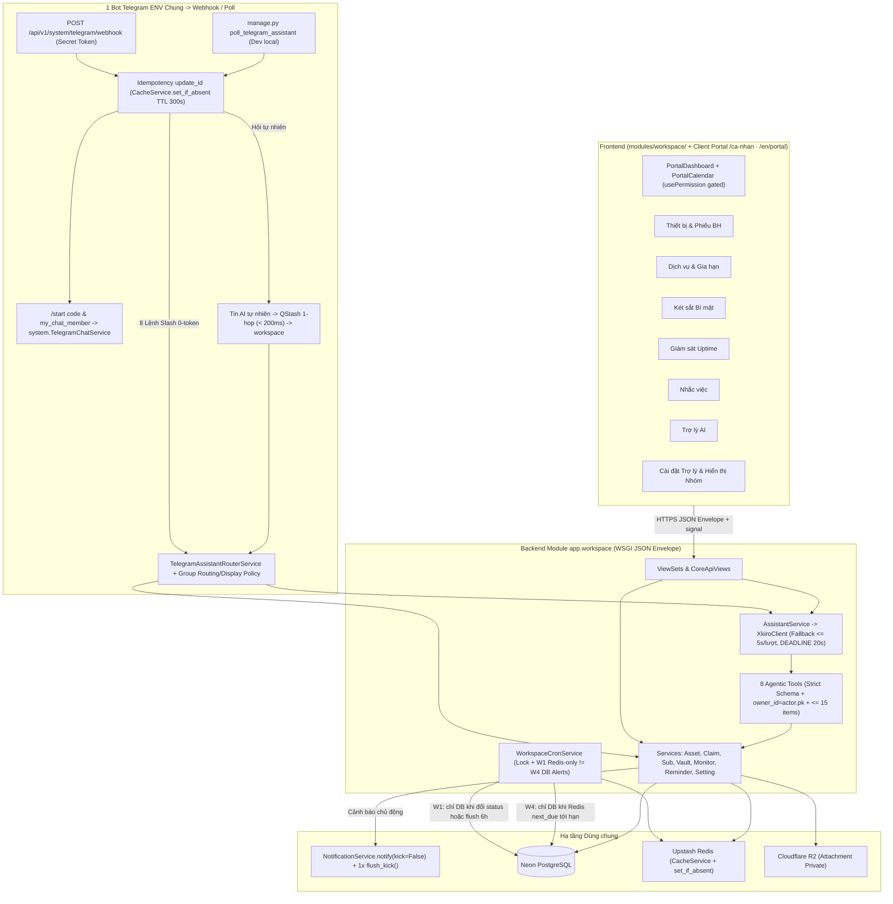
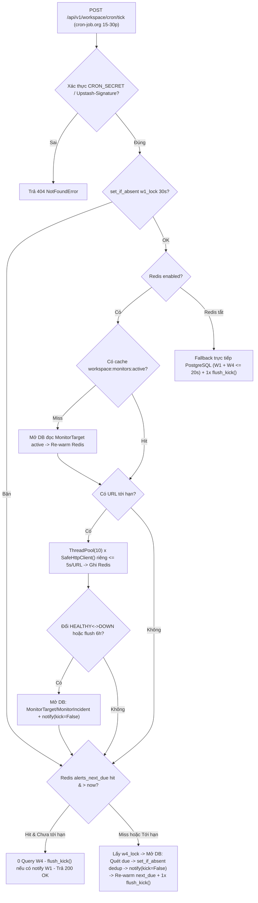

# Kế hoạch Thiết kế & Triển khai Chi tiết: Hệ điều hành Trợ lý Cá nhân & AI OS (`app.workspace` + Client Portal)

Tài liệu đặc tả kỹ thuật hoàn chỉnh (đã rà soát và khóa sạch toàn bộ điểm nghẽn theo 12 trục chuẩn repo ToanNX) để triển khai hệ thống trợ lý cá nhân: **100% giao diện tại Client Portal (`/ca-nhan` · `/en/portal`), không menu nào trong Admin (`/quan-tri`)**, phân lớp FE chuẩn **`modules/workspace/`** (không `navigation.ts`), chuẩn hóa **1 Bot Telegram dùng chung toàn hệ thống qua ENV**, phân quyền `ADMIN` toàn quyền theo IAM chuẩn ToanNX, Lịch Dashboard `date-fns`, Động cơ Cron Free-tier (Neon 0 CU khi rảnh, lock atomic Redis, re-warm on miss), và Trợ lý AI chuẩn OpenAI (`xKiro` Multi-Model Fallback `<= 5s`/turn + 8 Tools).

---

## Mục lục

1. [Phạm vi, Quyền (`ADMIN` Full Quyền vs Portal) & Ràng buộc Hạ tầng](#1-phạm-vi-quyền-admin-full-quyền-vs-portal--ràng-buộc-hạ-tầng)
2. [Kiến trúc Tổng thể, Chuẩn hóa Bot Telegram ENV & Tái sử dụng Common](#2-kiến-trúc-tổng-thể-chuẩn-hóa-bot-telegram-env--tái-sử-dụng-common)
3. [Thiết kế 11 Models Django ORM (`app.workspace`) & Refactor `system.Telegram` Trọn gói](#3-thiết-kế-11-models-django-orm-appworkspace--refactor-systemtelegram-trọn-gói)
4. [Đặc tả Đầy đủ API, ViewSets, Permissions, `Core*InFilter`, Search & Ordering](#4-đặc-tả-đầy-đủ-api-viewsets-permissions-coreinfilter-search--ordering)
5. [Động cơ Cron Động trên Serverless (Redis + QStash + `cron-job.org`, Neon 0 CU khi rảnh)](#5-động-cơ-cron-động-trên-serverless-redis--qstash--cron-joborg-neon-0-cu-khi-rảnh)
6. [Thiết kế Lịch Tương tác Dashboard (`PortalCalendar` với `date-fns`)](#6-thiết-kế-lịch-tương-tác-dashboard-portalcalendar-với-date-fns)
7. [Trí tuệ Nhân tạo Cá nhân (`xKiro` Multi-Model Fallback + 8 Tools + Guardrails)](#7-trí-tuệ-nhân-tạo-cá-nhân-xkiro-multi-model-fallback--8-tools--guardrails)
8. [Tương tác Telegram Hai chiều: 1 Bot Hệ thống Chung, Nhóm Từng User & Tùy chọn Hiển thị](#8-tương-tác-telegram-hai-chiều-1-bot-hệ-thống-chung-nhóm-từng-user--tùy-chọn-hiển-thị)
9. [Cấu hình Hệ thống, Biến môi trường, `ModuleDescriptor`, Mã lỗi & Rate Limits](#9-cấu-hình-hệ-thống-biến-môi-trường-moduledescriptor-mã-lỗi--rate-limits)
10. [Cấu trúc Frontend (`modules/workspace/` + `portal/` + `system/`), Route Song ngữ & Wireframe UI](#10-cấu-trúc-frontend-modulesworkspace--portal--system-route-song-ngữ--wireframe-ui)
11. [Kịch bản Kiểm thử Toàn diện (`pytest`, `Vitest`, `Playwright`)](#11-kịch-bản-kiểm-thử-toàn-diện-pytest-vitest-playwright)
12. [Lộ trình Triển khai & Tài liệu Cần cập nhật](#12-lộ-trình-triển-khai--tài-liệu-cần-cập-nhật)

---

## 1. Phạm vi, Quyền (`ADMIN` Full Quyền vs Portal) & Ràng buộc Hạ tầng

1. **Giao diện 100% Client Portal (`/ca-nhan` · `/en/portal`), cấu trúc FE chuẩn 1–1 với BE, Admin sạch 100% (`/quan-tri`)**:
   - Tuân thủ `docs/rules/frontend.md §1, §2`: toàn bộ `services/`, `permissions/`, `types/`, `schemas/`, `constants/`, `components/`, `views/`, `messages/{vi,en}.json` của module BE `app.workspace` nằm tại **`frontend/src/modules/workspace/`**.
   - **Không tạo `navigation.ts` trong `modules/workspace/` hay `modules/portal/`** và **không đăng ký bất kỳ mục nào vào `ADMIN_MODULE_NAVIGATION`** (`modules/manage-app/constants/admin-navigation.ts`) để bảo đảm Admin `/quan-tri` không có menu thừa và `tests/unit/module-registry.test.ts` pass.
   - `frontend/src/modules/portal/` giữ phần khung layout (`PortalShell`, `PortalSidebar`, `PortalBottomNav`) và `PortalDashboard`, còn App Router `app/[locale]/(client)/portal/.../page.tsx` import thẳng View từ `@/modules/workspace/views/...` (tương tự cách `portal/finance/*` đang dùng `@/modules/finance/views/...`).
2. **Phân quyền IAM chuẩn ToanNX — `ADMIN` full mọi quyền & mọi thao tác trên hệ thống**:
   - Mỗi tài nguyên khai 1 class `XxxPermission(PermissionCatalog)` riêng (mỗi model/view nghiệp vụ 1 file), có đủ `MANAGE_ALL` (không đưa `MANAGE_ALL` vào `MEMBER`).
   - **`ADMIN` (`auto_grant=ALL`, `is_superuser=True`) và vai trò có quyền `*.manage_all` (như `WORKSPACE_MANAGER` từ `seed_roles`) được toàn quyền xem, tạo, sửa, xóa, giải mã mọi bản ghi của mọi user trong hệ thống** — bao gồm cả `VaultItem` (`POST /reveal`, `PATCH`, `DELETE`), `WorkspaceSetting`, `AssistantConversation` và mọi tài nguyên khác qua `CoreCrudService` (và cả `TelegramChatService.verify`/`send_test` với `TelegramChatPermission.MANAGE_ALL`).
   - Vai trò `WORKSPACE_MEMBER` chỉ xem/sửa/xóa/giải mã bản ghi của chính mình (bản ghi người khác trả `404` chuẩn `CoreCrudService`).
   - Trên giao diện Client Portal (`/ca-nhan`), mọi query danh sách/báo cáo/lịch đều truyền bộ lọc `owner = currentUser.user.id` để giữ trải nghiệm Studio cá nhân; còn `VaultItem` trong API danh sách/chi tiết luôn che bản rõ mặc định (`••••••••xxxx`) và chỉ giải mã khi gọi `POST /vault-items/{id}/reveal` (có rate limit + audit `last_revealed_at` & `last_revealed_by`).
   - **Ngoại lệ chủ đích cho AI Tool cá nhân**: Khi `ADMIN` chat với trợ lý AI và hỏi _"Tháng này tôi chi/kiếm bao nhiêu?"_, toàn bộ AI tool cá nhân luôn lọc theo `owner_ids=[actor.pk]` / `filter(owner_id=actor.pk)` để AI không gộp số liệu của user khác vào câu trả lời cá nhân của `ADMIN`.
3. **Bot Telegram chuẩn hóa qua ENV — 1 Bot chung cho cả hệ thống, nhóm/chat ai cấu hình nấy**:
   - Toàn hệ thống dùng **duy nhất 1 Bot Telegram** do quản trị viên cấu hình qua biến môi trường (`TELEGRAM_BOT_TOKEN`, `TELEGRAM_BOT_USERNAME`). Bỏ hẳn luồng user tự nhập token `@BotFather` lưu DB.
   - Mọi màn hình cần kết nối Telegram (Hồ sơ → Thông báo, Cài đặt Trợ lý AI) đều **hiển thị `@username` của Bot hệ thống** và link `https://t.me/<bot_username>` cho **mọi người dùng đã đăng nhập** (bỏ khóa `isSuperuser`), để từng user tự kết nối DM hoặc thêm Bot vào nhóm chat (`system.TelegramChat`) của riêng mình.
4. **Kiến trúc Tác vụ Nền Serverless trên Vercel Hobby (Redis + QStash + `cron-job.org`, KHÔNG dùng Celery)**:
   - Đối chiếu `docs/reports/2026-11-22-background-jobs-plan.md` và `docs/architecture/infrastructure.md`: dùng **Upstash Redis (`CacheService`)** + **Upstash QStash (`QstashClient`)** + **`cron-job.org`** trên `@vercel/python` WSGI (0 GB-giờ idle, không chạm hạn mức 360 GB-giờ Vercel Daemon).
5. **Không giới hạn nhân tạo — chỉ giới hạn bởi hạ tầng Gói Free & quy tắc Timeout `<= 5s`**:
   - Đặt `owner_quota_setting = None` cho **toàn bộ** model trong `app.workspace`: tạo không giới hạn số lượng bản ghi trong ứng dụng.
   - Các ranh giới duy nhất là hạn mức thật của gói Free và chuẩn `.agents/rules/10-backend.md`:
     - **Mọi lời gọi dịch vụ ngoài có timeout `<= 5s`** (`SafeHttpClient.probe` max `5s`, `XKIRO_TIMEOUT_SECONDS` mặc định `5s` & chặn tối đa `5s`, `TelegramClient` `<= 5s`, `QstashClient` `<= 5s`).
     - **Neon PostgreSQL (1 GB / 100 CU-giờ/tháng)**: `DatabaseUsageService` giám sát 80%; Cron tick tách 2 đường Redis độc lập (`W1` ≠ `W4`) kèm cơ chế re-warm khi miss cache để Neon ngủ 0 CU khi rảnh; `cleanup_tasks` dọn log cũ > 90/180 ngày bằng `hard_delete_where`.
     - **Cloudflare R2 (10 GB)**: `AttachmentService` kiểm tổng dung lượng ở mức 90%.
     - **Vercel Hobby (300s/request, 4 giờ Active CPU/tháng)**: Ping Monitor `ThreadPoolExecutor(max_workers=10)`, `<= 5s`/URL, tổng budget `<= 20s`/lượt; AI `xKiro` tối đa 3 model/request trong tổng budget `<= 20s`.
     - **Upstash Redis (500k lệnh/tháng), QStash (1.000 tin/ngày) & xKiro Models**: fallback đa model tự động cho AI + fallback sạch sang PostgreSQL / `cron-job.org` / Slash commands `0 token`.
6. **Không thêm thư viện mới (chỉ dùng `requests` sẵn có gọi `xKiro`)**:
   - BE: `requests>=2.34.2`, `cryptography` (`SecretCipher`), `SafeHttpClient`, `calendar.monthrange` + `zoneinfo.ZoneInfo`.
   - FE: `date-fns ^4.4.0`, `getDateFnsLocale`, `date-time-input.ts`, `number-format.ts`, và common components trong `@/shares/components/common/`.

---

## 2. Kiến trúc Tổng thể, Chuẩn hóa Bot Telegram ENV & Tái sử dụng Common

### 2.1. Thành phần dùng lại & nâng cấp từ Core / System / Utilities / Finance

| Thành phần                                                                                         | Đường dẫn nguồn                                                                                    | Cách sử dụng / Nâng cấp                                                                                                                                                                                                                                                                                                                                                                                                                                                                                                                                                                                                                                                                                                                                                                                                                                                                                                                                                                                                                                  |
| -------------------------------------------------------------------------------------------------- | -------------------------------------------------------------------------------------------------- | -------------------------------------------------------------------------------------------------------------------------------------------------------------------------------------------------------------------------------------------------------------------------------------------------------------------------------------------------------------------------------------------------------------------------------------------------------------------------------------------------------------------------------------------------------------------------------------------------------------------------------------------------------------------------------------------------------------------------------------------------------------------------------------------------------------------------------------------------------------------------------------------------------------------------------------------------------------------------------------------------------------------------------------------------------- |
| `CoreModel`, `JournalTracker`, `CoreRepository`, `CoreCrudService`                                 | `app/core/`                                                                                        | Lớp nền CRUD, soft-delete, audit, owner scope, journal.                                                                                                                                                                                                                                                                                                                                                                                                                                                                                                                                                                                                                                                                                                                                                                                                                                                                                                                                                                                                  |
| `CoreModelViewSet`, `CoreApiView`, `@validate_request`, `@rate_limit`                              | `app/core/`                                                                                        | View chuẩn + OpenAPI `CoreAutoSchema`.                                                                                                                                                                                                                                                                                                                                                                                                                                                                                                                                                                                                                                                                                                                                                                                                                                                                                                                                                                                                                   |
| `SecretCipher`                                                                                     | `app/core/security/secret_cipher.py`                                                               | Mã hóa `VaultItem.secret_encrypted` với purpose `"workspace.vault.secret"`.                                                                                                                                                                                                                                                                                                                                                                                                                                                                                                                                                                                                                                                                                                                                                                                                                                                                                                                                                                              |
| `SafeHttpClient`, `PinnedHttpAdapter` (`validate_url_safety`, `is_ip_allowed`, `resolve_safe_ips`) | `app/utilities/utils/{safe_http_client.py,pinned_http_adapter.py}` → dời lên **`app/core/utils/`** | Dời cả 2 file (giữ 1 class/file theo `test_one_class_per_file.py`; cập nhật import `PinnedHttpAdapter` trong `safe_http_client.py:20`) lên `core/utils/` (cập nhật import ở `link_metadata_service.py`, cập nhật chuỗi `patch("app.core.utils.safe_http_client.SafeHttpClient.fetch_html", ...)` ở `app/utilities/tests/test_page_fetch_metadata_api.py:50`, dời `test_safe_http_client.py` sang `app/core/tests/` và đổi import/patch sang `app.core.utils.*`, cập nhật `docs/modules/utilities/README.md` và đường dẫn lệnh kiểm tra ở mục 3 `Lệnh tái xác nhận tự động` của `docs/reports/security-verification.md` — giữ nguyên các bảng lịch sử trong `docs/reports/`); bổ sung `probe(url, method, timeout)` tính tổng deadline cả chuỗi redirect `<= timeout` (`max 5s`), giữ `allow_redirects=False` kiểm `resolve_safe_ips` từng hop `Location`, `stream=True` + `response.close()` trong `finally`. **Mỗi worker thread khởi tạo `SafeHttpClient()` riêng** để không race condition `pinned_ips`/`Session`. Cập nhật `docs/common-catalog.md`. |
| `CacheService`                                                                                     | `app/core/cache/cache_service.py`                                                                  | Bổ sung **`set_if_absent(key, value, ttl_seconds) -> bool`** (`SET ... NX EX`, trả `True` khi Redis tắt) để lock atomic `workspace:cron:w1_lock`, `workspace:cron:w4_lock`, `system:tg:update:{update_id}`, `workspace:digest_sent:...`; giữ `get_json`/`set_json`/`delete` cho `workspace:monitors:active`, `workspace:monitor_state:{id}`, `workspace:cron:alerts_next_due`, `workspace:ai:model_cooldown:*`. Cập nhật `docs/common-catalog.md`.                                                                                                                                                                                                                                                                                                                                                                                                                                                                                                                                                                                                       |
| `NotificationService.notify`                                                                       | `app/system/services/notification_service.py`                                                      | Thêm tham số tùy chọn **`kick: bool = True`** cho `notify(...)` và method **`NotificationService.flush_kick()`** (nội bộ gọi `self.kick_service.kick()` khi có bản ghi vừa tạo chờ gửi) để `W4` truyền `kick=False` trong vòng lặp quét nhiều thông báo và cuối lượt chỉ gọi `self.notification_service.flush_kick()` **1 lần duy nhất**, giữ đúng ranh giới 1 cổng duy nhất qua `NotificationService`.                                                                                                                                                                                                                                                                                                                                                                                                                                                                                                                                                                                                                                                  |
| **Chuẩn hóa `Telegram` trong `app/system/`**                                                       | `app/system/`                                                                                      | Dùng **1 Bot ENV chung (`TELEGRAM_BOT_TOKEN`, `TELEGRAM_BOT_USERNAME`)**; giữ `TelegramChat` theo từng `owner`; gom webhook về `POST /api/v1/system/telegram/webhook`; đăng ký hook sang `app.workspace` qua `app/core/registry/` để **`system` không import `workspace`**. Thêm `reply_to_message_id` tùy chọn vào `TelegramClient.send_message` (timeout `<= 5s`).                                                                                                                                                                                                                                                                                                                                                                                                                                                                                                                                                                                                                                                                                     |
| `QstashClient`                                                                                     | `app/system/services/qstash_client.py`                                                             | Hẹn trễ tới từng phút cho Digest/Reminder (max 7 ngày) và chạy AI Telegram async 1-hop tránh timeout webhook Telegram.                                                                                                                                                                                                                                                                                                                                                                                                                                                                                                                                                                                                                                                                                                                                                                                                                                                                                                                                   |
| `Attachment` (`private`) + `AttachmentService`                                                     | `app/system/`                                                                                      | Hóa đơn thiết bị, phiếu BH, biên lai gia hạn (`visibility="private"`). FE dùng `<AttachmentPicker visibility="private" lockVisibility />`.                                                                                                                                                                                                                                                                                                                                                                                                                                                                                                                                                                                                                                                                                                                                                                                                                                                                                                               |
| `Currency`, `ExchangeRate`                                                                         | `app/system/`                                                                                      | Tham chiếu tiền tệ và tra tỷ giá theo ngày mua/ngày thanh toán.                                                                                                                                                                                                                                                                                                                                                                                                                                                                                                                                                                                                                                                                                                                                                                                                                                                                                                                                                                                          |
| `FinanceReportService.summary`                                                                     | `app/finance/services/finance_report_service.py`                                                   | AI Tool `get_finance_income_summary` gọi `summary(actor, year, month, owner_ids=[actor.pk])` và lọc `by_platform` theo tên nền tảng.                                                                                                                                                                                                                                                                                                                                                                                                                                                                                                                                                                                                                                                                                                                                                                                                                                                                                                                     |
| `PageService`, `NovelService`                                                                      | `app/utilities/`, `app/novel/`                                                                     | Bổ sung `list_stale_for(actor, cutoff)` luôn `.filter(owner_id=actor.pk)` cho AI Tool `get_stale_projects`.                                                                                                                                                                                                                                                                                                                                                                                                                                                                                                                                                                                                                                                                                                                                                                                                                                                                                                                                              |
| Helper & Common FE                                                                                 | `frontend/src/shares/`                                                                             | `DataTable`, `FilterSelect`, `SelectField`, `DatePicker`, `TimePicker`, `MoneyInput`, `TagsInput`, `StatusBadge`, `AttachmentPicker`, `RecordHistoryView`, `QueryErrorState`, `FormDialog`, `useTableState`, `useTabState`, `useBulkActions`, `getDateFnsLocale`, `date-time-input.ts`, `number-format.ts`, `toSafeHttpUrl`.                                                                                                                                                                                                                                                                                                                                                                                                                                                                                                                                                                                                                                                                                                                             |

### 2.2. Sơ đồ Luồng Tổng thể



---

## 3. Thiết kế 11 Models Django ORM (`app.workspace`) & Refactor `system.Telegram` Trọn gói

Tất cả **11 models** của `workspace` nằm trong `backend/app/workspace/models/` (mỗi model + enum `TextChoices` của chính model đó đúng 1 file snake_case). Model nghiệp vụ đặt `JournalTracker` trước `CoreModel` (trừ `MonitorIncident` và `AssistantMessage` dùng `CoreModel` thuần để tránh phình `JournalEntry`). Mọi index owner và unique constraint đều đặt `condition=Q(deleted_at__isnull=True)`.

### 3.0. Refactor trọn gói `TelegramBot` sang 1 Bot ENV chung (`app/system/` + `app/core/` + `FE`)

- **Env cấu hình Bot chung**: `TELEGRAM_BOT_TOKEN` (bí mật) và `TELEGRAM_BOT_USERNAME` (không có `@`, trống → gọi `getMe` qua timeout `<= 5s` rồi cache Redis `system:telegram:bot_info:v1`). Secret webhook dẫn xuất từ `DJANGO_SECRET_KEY`: `salted_hmac("system.telegram.webhook", sha256(token).hexdigest()).hexdigest()` (kiểm bằng `hmac.compare_digest` ở header `X-Telegram-Bot-Api-Secret-Token`).
- **Migration & Dọn Model/Permission/ErrorCode trong `app/system/`**:
  - Tạo migration gỡ FK `TelegramChat.bot` và bỏ bảng `TelegramBot`. Đổi constraint `uq_telegram_chat_bot_chat` (`fields=("bot", "chat_id")`) sang **`uq_telegram_chat_owner_chat` (`fields=("owner", "chat_id")`, `condition=Q(chat_id__isnull=False, deleted_at__isnull=True)`)**.
  - Xóa file: `models/telegram_bot.py` (gỡ khỏi `models/__init__.py`), `repositories/telegram_bot_repository.py`, `permissions/telegram_bot_permission.py` (gỡ `*TelegramBotPermission.all()` và `.member()` khỏi `system/module.py`), `serializers/validates/telegram_bot_validate_serializer.py`.
  - Gỡ 2 mã lỗi hết dùng khỏi `app/system/constants/notification_error_code.py` (`TELEGRAM_BOT_HAS_WEBHOOK`, `TELEGRAM_BOT_REQUIRED`) kèm xóa khóa dịch thừa tương ứng trong `frontend/src/messages/{vi,en}.json` để `test_error_codes.py` xanh.
- **Cập nhật Services & Views `app/system/`**:
  - `TelegramBotService`: đọc cấu hình từ `settings.TELEGRAM_BOT_TOKEN` / `settings.TELEGRAM_BOT_USERNAME` (`is_configured()`, `token()`, `bot_info()`, `webhook_secret()`, `setup_webhook()`, `check()`); giữ log cảnh báo kỹ thuật khi lỗi `401/404`.
  - `NotificationDispatcher._telegram` (`app/system/services/notification_dispatcher.py`): thay toàn bộ `chat.bot.is_active`, `token_of(chat.bot)`, `mark_token_invalid(chat.bot)` bằng `self.telegram_bot_service.is_configured()` và `self.telegram_bot_service.token()`.
  - `TelegramChatService` (`app/system/services/telegram_chat_service.py`): bỏ `require_for(actor)`, dùng `bot_info()["username"]` dựng link `https://t.me/<username>?start=...` / `?startgroup=...`, dùng `find_one(owner_id=chat.owner_id, chat_id=str(found["id"]))`; cập nhật `verify()` và `send_test()` dùng `self.get_for_write(actor, pk)` / tôn trọng quyền `TelegramChatPermission.MANAGE_ALL` (đảm bảo `ADMIN` thao tác được chat của mọi user); bổ sung `register_from_webhook_update(update)` kích hoạt `/start <code>` và `my_chat_member` trực tiếp từ Webhook (vẫn giữ `verify()` đọc `getUpdates` khi dev local không bật webhook).
  - `core.registry` (`ModuleRegistry`): thêm `register_telegram_update_handler(callable)` gọi tại `WorkspaceConfig.ready()` để `SystemTelegramWebhookView` chuyển tin nhắn trợ lý sang `app.workspace` mà `app.system` không import `app.workspace`.
  - Giữ tên class `TelegramBotView` (`GET /api/v1/system/telegram/bot`): `permission_classes = [IsActiveAuthenticated]` (thêm `"TelegramBotView"` vào `LOGIN_ONLY_VIEWS` của `test_endpoint_access.py`) để **mọi thành viên đã đăng nhập** xem được metadata `{ configured, username, display_name, bot_url }` của Bot chung (bỏ `PUT`/`DELETE`). Đổi `TelegramBotResponseSerializer` sang `serializers.Serializer` không gắn model.
  - Giữ tên class `TelegramBotCheckView` (`POST /api/v1/system/telegram/bot/check`): gắn `@require_permission(SettingPermission.SETTING_UPDATE)` (quản trị hệ thống), cập nhật `TelegramBotCheckResponseSerializer` trả `{ bot, webhook_active, webhook_url, last_error_code }` sau khi `getMe` + `setWebhook` + `getWebhookInfo`.
  - Thêm `SystemTelegramWebhookView` (`POST /api/v1/system/telegram/webhook`, `authentication_classes=[]`, `permission_classes=[AllowAny]`, thêm vào `PUBLIC_VIEWS` ở `test_endpoint_access.py`).
- **Cập nhật Test Backend & Frontend `system` liên quan `TelegramBot` (tránh fail CI/khóa UI)**:
  - Backend: cập nhật `backend/app/system/tests/test_telegram_bot_api.py`, **`backend/app/core/tests/test_list_query_count.py`** (gỡ import và `TelegramBot.objects.get_or_create` trong `_system`), **`backend/app/system/tests/test_notification_preference_api.py`** (gỡ `TelegramBot.objects.create`), `backend/app/core/tests/test_endpoint_access.py`.
  - Frontend: sửa **`notification-settings-tab.tsx`**, **`use-portal-profile.ts`** và **`profile-dialog.tsx`** (bỏ điều kiện `isSuperuser && TELEGRAM_BOT_PERMISSIONS.read`; mọi user có quyền `TELEGRAM_CHAT_PERMISSIONS.read` đều xem được `@bot_username` và dùng `TelegramChatList` + công tắc kênh Telegram khi `bot.data?.configured`); sửa `telegram-bot-card.tsx`, `use-telegram-bot-card.ts`, `telegram-bot.service.ts`, `use-telegram-bot.ts`, `use-check-telegram-bot.ts`, `types/notification.types.ts` (ẩn nút `Kiểm tra / Đồng bộ Webhook` nếu thiếu `SETTING_PERMISSIONS.update`); xóa code chết `telegram-bot-permission.ts`, `use-save-telegram-bot.ts`, `use-delete-telegram-bot.ts`; cập nhật `system/messages/{vi,en}.json` và `frontend/tests/unit/portal-profile.test.tsx`.

### 3.1. `Asset` — Thiết bị, Nơi mua & Hạn bảo hành (`models/asset.py`)

Kế thừa `(JournalTracker, CoreModel)`:

- **Định danh thiết bị**: `owner` (`FK User, CASCADE`), `name` (`CharField(200)`), `brand` (`CharField(100)`), `model_code` (`CharField(100)`), `category` (`LAPTOP`, `PHONE`, `TABLET`, `MONITOR`, `PERIPHERAL`, `AUDIO`, `NETWORK`, `CAMERA`, `OTHER`), `serial_number` (`CharField(100)`), `imei` (`CharField(50)`), `specs` (`JSONField(default=dict)`), `status` (`IN_USE`, `BACKUP`, `IN_WARRANTY`, `IN_REPAIR`, `SOLD`, `BROKEN`).
- **Nơi mua & Giá mua lịch sử**: `purchase_date` (`DateField()`), `purchase_price` (`DecimalField(18, 2)`), `currency` (`FK system.Currency, PROTECT`), `exchange_rate` (`DecimalField(18, 6)`), `purchase_price_vnd` (`DecimalField(18, 0)`), `purchase_store` (`CharField(150)`), `purchase_channel` (`OFFICIAL_STORE`, `RETAILER`, `ECOMMERCE`, `SECOND_HAND`, `COMPANY`, `GIFT`), `purchase_branch_address` (`CharField(255, blank=True)`), `purchase_order_code` (`CharField(100, blank=True)`), `purchase_order_url` (`URLField(500, blank=True)`), `store_warranty_contact` (`CharField(150, blank=True)`).
  - **Quy tắc tỷ giá bắt buộc** (áp dụng cho `Asset`, `AssetWarrantyClaim`, `Subscription`, `SubscriptionPayment`): Khi `currency.code == DEFAULT_CURRENCY_CODE` (`VND`) thì service ép `exchange_rate = Decimal("1")` và quy đổi VNĐ tròn đồng. Khi chọn **ngoại tệ khác**, nếu không truyền `exchange_rate` thì tra tỷ giá gần nhất trong `system.ExchangeRate` (`rate_date <= ngày chứng từ`); **nếu không có tỷ giá tham chiếu thì raise `ValidationError` yêu cầu nhập `exchange_rate > 0`**, tuyệt đối không dùng `default=1` gây lệch tiền.
- **Thời gian & Chính sách Bảo hành**: `warranty_type` (`MANUFACTURER`, `STORE`, `EXTENDED`, `NONE`), `warranty_months` (`PositiveIntegerField(null=True, blank=True)`), `warranty_start_date` (`DateField(null=True, blank=True)`, mặc định = `purchase_date`), `warranty_end_date` (`DateField(null=True, blank=True, db_index=True)` — tự tính qua `add_months_clamped(warranty_start_date, warranty_months, anchor_day=warranty_start_date.day)` nếu bỏ trống), `warranty_provider` (`CharField(150, blank=True)`), `warranty_note` (`TextField(blank=True)`).
- **Hóa đơn & Ghi chú**: `invoice_attachments` (`M2M("system.Attachment", blank=True)` — `visibility="private"`), `notes` (`TextField(blank=True)`).
- **Indexes & Annotations**: Partial indexes `(owner, warranty_end_date)` và `(owner, status)` với `condition=Q(deleted_at__isnull=True)`. `AssetRepository.get_queryset()` annotate 0 N+1: `warranty_claim_count`, `repair_count`, `total_claim_count`, `open_claim_count`, `total_service_cost_vnd`, `last_claim_date`.

### 3.2. `AssetWarrantyClaim` — Phiếu Bảo hành & Sửa chữa (`models/asset_warranty_claim.py`)

Kế thừa `(JournalTracker, CoreModel)`:

- `owner` (`FK User, CASCADE`), `asset` (`FK Asset, CASCADE, related_name="warranty_claims"`).
- `claim_code` (`CharField(32)`): Tự sinh dạng `BH-YYYYMM-NNN` (retry chống trùng đồng thời) nếu để trống; `UniqueConstraint(fields=["owner", "claim_code"], condition=Q(deleted_at__isnull=True), name="uq_workspace_claim_owner_code")`.
- `claim_type` (`WARRANTY`, `PAID_REPAIR`, `MAINTENANCE`), `status` (`SUBMITTED`, `INSPECTING`, `WAITING_PARTS`, `COMPLETED`, `REJECTED`, `CANCELLED`).
- `submitted_date` (`DateField()`), `estimated_return_date` (`DateField(null=True, blank=True)`), `returned_date` (`DateField(null=True, blank=True)`).
- `service_center` (`CharField(200)`), `service_center_address`, `service_center_contact`, `external_ticket_code`.
- `issue_description`, `resolution_notes`, `is_covered_by_warranty`, `cost`, `currency`, `exchange_rate`, `cost_vnd`.
- `part_warranty_months`, `part_warranty_end_date` (tự tính bằng `add_months_clamped` khi có `returned_date` + `part_warranty_months`), `attachments` (`M2M("system.Attachment", blank=True)`, `private`).
- **Đồng bộ trạng thái**: Tạo/mở phiếu cho thiết bị thuộc đúng `owner` của thiết bị (`404` nếu chọn thiết bị của user khác trừ khi có `manage_all`); máy đang `IN_USE` tự sang `IN_WARRANTY`/`IN_REPAIR`, đóng mọi phiếu mở về `COMPLETED`/`REJECTED`/`CANCELLED` → máy về `IN_USE`.

### 3.3. `Subscription` & `SubscriptionPayment` (`models/subscription.py`, `models/subscription_payment.py`)

- **`Subscription`** `(JournalTracker, CoreModel)`:
  - `owner`, `name`, `provider`, `category` (`DOMAIN`, `HOSTING_VPS`, `SAAS_TOOL`, `ENTERTAINMENT`, `TELECOM`, `OTHER`).
  - `billing_cycle` (`WEEKLY`, `MONTHLY`, `QUARTERLY`, `SEMI_ANNUAL`, `YEARLY`, `CUSTOM_DAYS`), `custom_cycle_days` (`PositiveIntegerField(null=True)` — bắt buộc `> 0` khi `CUSTOM_DAYS`).
  - `anchor_day` (`PositiveSmallIntegerField(default=1)`): Giữ ngày gốc `1–31` khi cộng tháng qua `add_months_clamped` (`WEEKLY`: `+7 ngày`; `MONTHLY`: `+1 tháng`; `QUARTERLY`: `+3 tháng`; `SEMI_ANNUAL`: `+6 tháng`; `YEARLY`: `+12 tháng`; `CUSTOM_DAYS`: `+custom_cycle_days`).
  - `amount`, `currency`, `exchange_rate`, `amount_vnd`, `renew_date` (`db_index=True`), `auto_renew`, `payment_method`, `manage_url`, `reminder_days_before` (`[7, 3, 1]`), `is_active`, `notes`.
- **`SubscriptionPayment`** `(JournalTracker, CoreModel)`:
  - `owner` (`FK User`), `subscription` (`FK Subscription, CASCADE, related_name="payments"`).
  - `paid_on` (`DateField(db_index=True)`), `period_from` (`DateField()`), `period_to` (`DateField()`).
  - `amount`, `currency`, `exchange_rate`, `amount_vnd`, `payment_method`, `receipt_attachment` (`FK Attachment, SET_NULL, null=True`, `private`), `note`.
  - Endpoint `POST /api/v1/workspace/subscriptions/{id}/renew` nhận optional `paid_on`, `amount`, `exchange_rate`, `receipt_attachment_id`, `note`, `advance_from` (`"cycle"` mặc định hoặc `"today"`):
    - Nếu `subscription.currency` là ngoại tệ và user không gửi `exchange_rate`, **bắt buộc tra `ExchangeRate` mới nhất `<= paid_on`** (nếu không có tỷ giá hợp lệ → raise `ValidationError` bắt nhập `exchange_rate > 0`, không dùng lại tỷ giá cũ từ nhiều tháng trước của `Subscription`).
    - Tính `period_from`/`period_to` theo `anchor_day`, ghi nhận `SubscriptionPayment` với `amount_vnd` của kỳ thanh toán đó (giữ nguyên `Subscription.amount` niêm yết gốc), và cập nhật `subscription.renew_date = period_to` trong cùng transaction.

### 3.4. `VaultItem` — Két sắt Bí mật (`models/vault_item.py`)

Kế thừa `(JournalTracker, CoreModel)`, `journal_masked_fields = ("secret_encrypted", "secret_last4")`:

- `owner` (`FK User`), `title` (`CharField(200)`), `category` (`SERVER`, `API_KEY`, `ACCOUNT`, `SNIPPET`, `ENV_CONFIG`, `OTHER`).
- `username` (`CharField(200)`), `secret_encrypted` (`TextField()` — mã hóa `SecretCipher` purpose `"workspace.vault.secret"`), `secret_last4` (`CharField(4)`).
- `url` (`CharField(500)`), `notes` (`TextField`), `tags` (`JSONField(default=list)`), `last_revealed_at` (`DateTimeField(null=True)`), **`last_revealed_by` (`FK User, null=True, blank=True, on_delete=SET_NULL, related_name="+"`)** (ghi vết khi chính chủ hoặc `ADMIN`/`manage_all` mở xem).
- Lưu ý: Khi cập nhật `VaultItem` không gửi trường `secret` (hoặc gửi chuỗi rỗng), giữ nguyên `secret_encrypted` & `secret_last4` cũ.

### 3.5. `MonitorTarget` & `MonitorIncident` (`models/monitor_target.py`, `models/monitor_incident.py`)

- **`MonitorTarget`** `(JournalTracker, CoreModel)`:
  - `owner` (`FK User`), `name`, `url` (`URLField(500)` — kiểm SSRF cả lúc `create/update` bằng serializer + mã lỗi `WORKSPACE_MONITOR_URL_UNSAFE` và lúc `probe` qua `SafeHttpClient` + `PinnedHttpAdapter`), `method` (`GET`/`HEAD`).
  - `expected_status` (`PositiveIntegerField(default=200)` — hỗ trợ khoảng `200..399` hoặc mã cụ thể), **`timeout_seconds` (`PositiveSmallIntegerField(default=4)`, min `1`, max `5`)** (tuân thủ `<= 5s`), `check_interval_minutes` (`PositiveIntegerField(default=30)`, min `15`).
  - `is_active` (`BooleanField(default=True)`), `last_status` (`HEALTHY`, `DEGRADED`, `DOWN`, `UNKNOWN`), `last_status_code`, `last_latency_ms`, `last_checked_at`, `consecutive_failures` (`default=0`).
- **`MonitorIncident`** `(CoreModel)`:
  - `owner` (`FK User`), `target` (`FK MonitorTarget, CASCADE, related_name="incidents"`).
  - `started_at` (`DateTimeField(db_index=True)`), `resolved_at` (`DateTimeField(null=True)`), `status_code` (`IntegerField(null=True)`), `error_message` (`TextField(blank=True)`), `duration_seconds` (`PositiveIntegerField(null=True)`).

### 3.6. `Reminder` — Nhắc việc Cá nhân (`models/reminder.py`)

Kế thừa `(JournalTracker, CoreModel)`:

- `owner` (`FK User`), `title` (`CharField(255)`), `description` (`TextField(blank=True)`).
- `due_date` (`DateField(db_index=True)`), `due_time` (`TimeField(null=True)`), `notify_minutes_before` (`PositiveSmallIntegerField(default=0)`).
- `priority` (`LOW`, `MEDIUM`, `HIGH`, `URGENT`), `is_completed` (`BooleanField(default=False, db_index=True)`), `completed_at` (`DateTimeField(null=True)`).
- `recurrence` (`NONE`, `DAILY`, `WEEKLY`, `MONTHLY`, `YEARLY`), `anchor_day` (`PositiveSmallIntegerField(null=True)`), `tags` (`JSONField(default=list)`).
- Khi đánh dấu hoàn thành (`is_completed = True`) cho nhắc việc có `recurrence != NONE`, tự sinh bản `Reminder` kỳ kế tiếp (theo `anchor_day`) và cập nhật Redis `next_due` + QStash nếu trong 7 ngày.

### 3.7. `WorkspaceSetting` — Cấu hình Cron Động, AI & Hiển thị Telegram (`models/workspace_setting.py`)

Kế thừa `(JournalTracker, CoreModel)`:

- **`owner` (`ForeignKey(User, CASCADE, related_name="workspace_settings")`)** + `UniqueConstraint(fields=["owner"], condition=Q(deleted_at__isnull=True), name="uq_workspace_setting_owner")`.
- **Lịch & Digest cá nhân**:
  - `timezone` (`CharField(64, default="Asia/Ho_Chi_Minh")`), `daily_digest_enabled` (`BooleanField(default=True)`).
  - `digest_time_slots` (`JSONField(default=list)` — VD `["08:00", "20:30"]`, validate `HH:MM`, khử trùng lặp).
  - **`digest_sections` (`JSONField(default=list)`)**: Danh sách khối user muốn hiện trong Digest (mặc định đủ `["reminders", "warranty", "subscriptions", "monitors", "finance"]`).
  - `warranty_alert_days` (`[30, 7, 1]`), `subscription_default_alert_days` (`[7, 3, 1]`).
- **Tùy biến AI & Hiển thị Telegram Group Chat (user tự cấu hình cách hiển thị)**:
  - `preferred_ai_model` (`CharField(120, blank=True, default="")` — rỗng = theo thứ tự `XKIRO_MODEL` → `XKIRO_FALLBACK_MODELS`).
  - `ai_daily_token_limit` (`PositiveIntegerField(null=True, blank=True, default=None)`).
  - `telegram_ai_enabled` (`BooleanField(default=False)`).
  - `telegram_owner_user_id` (`BigIntegerField(null=True, blank=True)` — tự động gắn khi chính chủ `/start <code>` hoặc `/verify_owner` từ DM).
  - `telegram_allowed_chat_ids` (`JSONField(default=list)` — danh sách ID bản ghi `system.TelegramChat` đang active của user được bật tương tác Trợ lý).
  - `telegram_group_require_mention` (`BooleanField(default=True)` — bắt buộc `@bot`, reply bot hoặc `/cmd@bot`).
  - **`telegram_group_tool_policy` (`TextChoices`, default=`OWNER_ONLY`)**: `DISABLED` | `OWNER_ONLY` | `ALL_MEMBERS`.
  - **`telegram_group_hide_amounts` (`BooleanField(default=False)`)**: Che/ẩn con số tiền tệ nhạy cảm (giá mua, chi tiêu, thu nhập) khi bot trả lời trong Group.
  - **`telegram_group_reply_in_dm` (`BooleanField(default=False)`)**: Nếu câu hỏi có dữ liệu riêng tư (`contains_private_data=True`), gửi chi tiết vào Private DM của chính chủ và chỉ phản hồi tóm tắt ngắn ngoài Group (lưu ý: chỉ áp dụng DM riêng tư cho chính chủ `telegram_owner_user_id`; nếu `403` do chưa `/start` bot ở DM, fallback nhắn ngắn ngoài Group hướng dẫn bấm mở DM `https://t.me/<bot_username>`).

### 3.8. `AssistantConversation` & `AssistantMessage` (`models/assistant_conversation.py`, `models/assistant_message.py`)

- **`AssistantConversation`** `(JournalTracker, CoreModel)`:
  - `owner` (`FK User`), `channel` (`WEB`, `TELEGRAM_DM`, `TELEGRAM_GROUP`), `external_chat_id` (`CharField(64, blank=True, default="", db_index=True)`), `title` (`CharField(200)`), `last_message_at` (`DateTimeField(null=True)`).
- **`AssistantMessage`** `(CoreModel)`:
  - `conversation` (`FK AssistantConversation, CASCADE, related_name="messages"`).
  - `role` (`USER`, `ASSISTANT`, `TOOL`, `SYSTEM`), `sender_telegram_id` (`BigIntegerField(null=True)`), `sender_name` (`CharField(150, blank=True)`).
  - `content` (`TextField()`), `tool_calls` (`JSONField(null=True)`), `tool_call_id` (`CharField(100, blank=True)`), **`model_used` (`CharField(120, blank=True, default="")`)**, `tokens_used` (`PositiveIntegerField(default=0)`), **`contains_private_data` (`BooleanField(default=False)`)**, `is_error` (`BooleanField(default=False)`).
  - _Quy ước repository/service_: `AssistantMessage` không dùng `CoreCrudService` trực tiếp mà đọc/ghi qua `AssistantConversationService` (`CoreCrudService`, `owner_field="owner"`, `manage_all_permission=AssistantConversationPermission.MANAGE_ALL.code`).

---

## 4. Đặc tả Đầy đủ API, ViewSets, Permissions, `Core*InFilter`, Search & Ordering

Tất cả endpoint tuân thủ `APPEND_SLASH = False`, dưới `/api/v1/workspace/...` (và phần bot dùng chung ở `/api/v1/system/...`); trong `app/workspace/urls.py`, mọi `APIView` (kể cả `AssistantConversationMessagesView`) khai báo **trước** `router.urls` để không bị route chi tiết `{pk}` nuốt. Mọi `@action` và `APIView` đều gắn `@extend_schema` với `*ValidateSerializer` (`CoreValidateSerializer`) / `*ResponseSerializer` riêng từng file (`test_one_class_per_file.py`). Mỗi class `XxxPermission` đặt 1 file riêng trong `app/workspace/permissions/`: `AssetPermission`, `AssetWarrantyClaimPermission`, `SubscriptionPermission`, `SubscriptionPaymentPermission`, `VaultItemPermission` (có thêm `REVEAL` trong `MEMBER`), `MonitorTargetPermission`, `MonitorIncidentPermission`, `ReminderPermission`, `WorkspaceSettingPermission`, `AssistantConversationPermission`, `AssistantPermission` (`CHAT`), `WorkspaceDashboardPermission` (`READ`, `MANAGE_ALL`), `WorkspaceCalendarPermission` (`READ`, `MANAGE_ALL`). Mọi `CoreModelViewSet` có `list` đều được thêm dòng vào `backend/app/core/tests/test_list_query_count.py`.

| Resource / Endpoint                                                                                                                                                                          | Lớp View & Quyền chi tiết (`action_permissions` / `@require_permission`)                                                                                                                                                                                                                                                                                                              | Filter (`Core*InFilter`) / Search / Ordering                                                                                                                                                                                                                                                | Bulk / Custom Actions & Ghi chú                                                                                                                                                                                                                                          |
| -------------------------------------------------------------------------------------------------------------------------------------------------------------------------------------------- | ------------------------------------------------------------------------------------------------------------------------------------------------------------------------------------------------------------------------------------------------------------------------------------------------------------------------------------------------------------------------------------- | ------------------------------------------------------------------------------------------------------------------------------------------------------------------------------------------------------------------------------------------------------------------------------------------- | ------------------------------------------------------------------------------------------------------------------------------------------------------------------------------------------------------------------------------------------------------------------------ |
| `AssetViewSet`<br>`/workspace/assets`                                                                                                                                                        | `CoreModelViewSet[Asset]`<br>`list/retrieve/create/partial_update/destroy` (`AssetPermission`)                                                                                                                                                                                                                                                                                        | `category`, `status`, `warranty_type`, `purchase_channel`, `owner`<br>Search: `name`, `brand`, `model_code`, `serial_number`, `imei`, `purchase_store`, `purchase_order_code`<br>Order: `purchase_date`, `warranty_end_date`, `purchase_price_vnd`, `created_at` (`-created_at`)            | `bulk_delete_enabled = True`<br>`history_enabled = True`                                                                                                                                                                                                                 |
| `AssetWarrantyClaimViewSet`<br>`/workspace/warranty-claims`                                                                                                                                  | `CoreModelViewSet[AssetWarrantyClaim]`<br>`list/retrieve/create/partial_update/destroy` (`AssetWarrantyClaimPermission`)                                                                                                                                                                                                                                                              | `asset`, `claim_type`, `status`, `is_covered_by_warranty`, `owner`<br>Search: `claim_code`, `external_ticket_code`, `service_center`, `issue_description`, `asset__name`<br>Order: `submitted_date`, `estimated_return_date`, `returned_date`, `cost_vnd`, `created_at` (`-submitted_date`) | `bulk_delete_enabled = True`<br>`history_enabled = True`                                                                                                                                                                                                                 |
| `SubscriptionViewSet`<br>`/workspace/subscriptions`                                                                                                                                          | `CoreModelViewSet[Subscription]`<br>`action_permissions` gồm cả `"renew": SubscriptionPermission.UPDATE`                                                                                                                                                                                                                                                                              | `category`, `billing_cycle`, `is_active`, `auto_renew`, `owner`<br>Search: `name`, `provider`, `payment_method`<br>Order: `renew_date`, `amount_vnd`, `created_at` (`renew_date`)                                                                                                           | `bulk_delete_enabled = True`<br>`bulk_update_serializer_class` (`is_active`)<br>`@action renew` (`POST`, `@extend_schema`: `SubscriptionRenewValidateSerializer` → `SubscriptionPaymentResponseSerializer`)<br>`history_enabled = True`                                  |
| `SubscriptionPaymentViewSet`<br>`/workspace/subscription-payments`                                                                                                                           | `CoreModelViewSet[SubscriptionPayment]`<br>`"create": DENY, "partial_update": DENY` (`SubscriptionPaymentPermission`)                                                                                                                                                                                                                                                                 | `subscription`, `currency`, `owner`<br>Search: `subscription__name`, `payment_method`, `note`<br>Order: `paid_on`, `amount_vnd`, `created_at` (`-paid_on`)                                                                                                                                  | `bulk_delete_enabled = True`<br>`http_method_names = ["get", "post", "delete", "head", "options"]`<br>`history_enabled = False`                                                                                                                                          |
| `VaultItemViewSet`<br>`/workspace/vault-items`                                                                                                                                               | `CoreModelViewSet[VaultItem]`<br>`action_permissions` gồm `"reveal": VaultItemPermission.REVEAL`                                                                                                                                                                                                                                                                                      | `category`, `owner`<br>Search: `title`, `username`, `url`, `notes`<br>Order: `title`, `last_revealed_at`, `created_at` (`-created_at`)                                                                                                                                                      | `bulk_delete_enabled = True`<br>`@action reveal` (`POST`, `request=None` → `VaultItemRevealResponseSerializer`, `@rate_limit("workspace.vault.reveal")`, audit `last_revealed_at` + `last_revealed_by`)<br>`history_enabled = True`                                      |
| `MonitorTargetViewSet`<br>`/workspace/monitor-targets`                                                                                                                                       | `CoreModelViewSet[MonitorTarget]`<br>`action_permissions` gồm `"ping": MonitorTargetPermission.UPDATE`                                                                                                                                                                                                                                                                                | `last_status`, `is_active`, `method`, `owner`<br>Search: `name`, `url`<br>Order: `last_checked_at`, `last_latency_ms`, `created_at` (`-created_at`)                                                                                                                                         | `bulk_delete_enabled = True`<br>`bulk_update_serializer_class` (`is_active`)<br>`@action ping` (`POST`, `request=None` → `MonitorTargetPingResponseSerializer`, `@rate_limit("workspace.monitor.ping")`)<br>`history_enabled = True` _(trộn state Redis nếu mới hơn DB)_ |
| `MonitorIncidentViewSet`<br>`/workspace/monitor-incidents`                                                                                                                                   | `CoreModelViewSet[MonitorIncident]`<br>`"create": DENY, "partial_update": DENY` (`MonitorIncidentPermission`)                                                                                                                                                                                                                                                                         | `target`, `status_code`, `owner` (+ `resolved`: `CoreBooleanInFilter`)<br>Search: `target__name`, `error_message`<br>Order: `started_at`, `duration_seconds`, `created_at` (`-started_at`)                                                                                                  | `bulk_delete_enabled = True`<br>`http_method_names = ["get", "post", "delete", "head", "options"]`<br>`history_enabled = False`                                                                                                                                          |
| `ReminderViewSet`<br>`/workspace/reminders`                                                                                                                                                  | `CoreModelViewSet[Reminder]`<br>`list/retrieve/create/partial_update/destroy` (`ReminderPermission`)                                                                                                                                                                                                                                                                                  | `priority`, `is_completed`, `recurrence`, `owner` (+ `due_from`, `due_to`)<br>Search: `title`, `description`<br>Order: `due_date`, `priority`, `created_at` (`due_date`)                                                                                                                    | `bulk_delete_enabled = True`<br>`bulk_update_serializer_class` (`is_completed`)<br>`history_enabled = True`                                                                                                                                                              |
| `AssistantConversationViewSet` + `AssistantConversationMessagesView`<br>`/workspace/assistant/conversations` & `.../<uuid:pk>/messages`                                                      | `CoreModelViewSet[AssistantConversation]` (`"create": DENY, "partial_update": DENY`; `list` giữ queryset gọn nhẹ **không** prefetch `messages`, chỉ `retrieve` lấy tối đa `50` tin gần nhất + `has_more_messages` qua method riêng của `AssistantConversationService`) & `CoreApiView` (`GET`, `@require_permission(AssistantConversationPermission.READ)`, khai trước `router.urls`) | `channel`, `owner`<br>Search: `title`<br>Order: `last_message_at`, `created_at` (`-last_message_at`)                                                                                                                                                                                        | `bulk_delete_enabled = True`<br>`http_method_names = ["get", "post", "delete", "head", "options"]`<br>`history_enabled = False`<br>`/messages` hỗ trợ phân trang chuẩn để tải lịch sử cũ.                                                                                |
| `WorkspaceSettingView` & `WorkspaceSettingObjectView`<br>`/workspace/settings` & `/workspace/settings/<uuid:owner_id>`                                                                       | `CoreApiView`: `WorkspaceSettingView` (`GET`: `@require_permission(WorkspaceSettingPermission.READ)`, `PUT/PATCH`: `WorkspaceSettingPermission.UPDATE`); `WorkspaceSettingObjectView` (`GET`/`PUT`/`PATCH`: `@require_permission(WorkspaceSettingPermission.MANAGE_ALL)`, kiểm tra `owner_id` tồn tại trong `User` trước khi `get_or_create`, không có trả `404 NotFoundError`)       | —                                                                                                                                                                                                                                                                                           | `@rate_limit("default.write")`                                                                                                                                                                                                                                           |
| `WorkspaceDashboardSummaryView`<br>`/workspace/dashboard/summary`                                                                                                                            | `CoreApiView`<br>`GET`: `@require_permission(WorkspaceDashboardPermission.READ)`                                                                                                                                                                                                                                                                                                      | `?owner=` (chỉ áp dụng cho user khác khi có `WorkspaceDashboardPermission.MANAGE_ALL`, nếu không luôn ép `actor.pk`)                                                                                                                                                                        | Trả 4 chỉ số KPI tổng hợp (Chi tháng, Việc hôm nay, Thiết bị sắp hết BH, Monitor OK).                                                                                                                                                                                    |
| `WorkspaceCalendarView`<br>`/workspace/calendar`                                                                                                                                             | `CoreApiView`<br>`GET`: `@require_permission(WorkspaceCalendarPermission.READ)`                                                                                                                                                                                                                                                                                                       | `?from=YYYY-MM-DD&to=YYYY-MM-DD&types=...&owner=` (ép `actor.pk` nếu thiếu `WorkspaceCalendarPermission.MANAGE_ALL`)                                                                                                                                                                        | Gom 5 nguồn sự kiện theo `ZoneInfo(setting.timezone)`.                                                                                                                                                                                                                   |
| `AssistantChatView`<br>`/workspace/assistant/chat`                                                                                                                                           | `CoreApiView`<br>`POST`: `@require_permission(AssistantPermission.CHAT)`                                                                                                                                                                                                                                                                                                              | —                                                                                                                                                                                                                                                                                           | `@rate_limit("workspace.assistant.chat")`; chạy `AssistantService` (`xKiro` Fallback `<= 5s`/lượt + 8 Tools).                                                                                                                                                            |
| `WorkspaceCronTickView` & `WorkspaceCronDispatchDueView` & `TelegramAssistantProcessView`<br>`/workspace/cron/tick`, `/workspace/cron/dispatch-due`, `/workspace/assistant/telegram-process` | `CoreApiView`<br>`POST`: `authentication_classes = []`, `permission_classes = [AllowAny]` (tất cả đều khai vào `PUBLIC_VIEWS` ở `test_endpoint_access.py`)                                                                                                                                                                                                                            | —                                                                                                                                                                                                                                                                                           | `cron/tick` kiểm `Bearer <CRON_SECRET>` hoặc `Upstash-Signature`; `dispatch-due` & `telegram-process` kiểm `Upstash-Signature` (hoặc `CRON_SECRET`), sai trả `404`; `@rate_limit` tương ứng.                                                                             |
| **System Telegram Chung** (`app/system/`)<br>`GET /system/telegram/bot`<br>`POST /system/telegram/bot/check`<br>`POST /system/telegram/webhook`                                              | `TelegramBotView` (`CoreApiView`, `GET`, `permission_classes=[IsActiveAuthenticated]`, thêm vào `LOGIN_ONLY_VIEWS`)<br>`TelegramBotCheckView` (`CoreApiView`, `POST`, `@require_permission(SettingPermission.SETTING_UPDATE)`)<br>`SystemTelegramWebhookView` (`CoreApiView`, `POST`, `authentication_classes=[]`, `permission_classes=[AllowAny]`, thêm vào `PUBLIC_VIEWS`)          | —                                                                                                                                                                                                                                                                                           | Bỏ `PUT/DELETE /system/telegram/bot`; `SystemTelegramWebhookView` kiểm `X-Telegram-Bot-Api-Secret-Token`; `TelegramChatViewSet` giữ nguyên theo từng `owner` + `MANAGE_ALL`.                                                                                             |

---

## 5. Động cơ Cron Động trên Serverless (Redis + QStash + `cron-job.org`, Neon 0 CU khi rảnh)

### 5.1. Đánh giá phương án nền trên Vercel

- **Celery + Redis trên Vercel Daemons**: Không khả thi trên Hobby (1 container 0.5 GB × 720h = `360 GB-giờ` hết 100% hạn mức Memory Hobby, Celery Beat đốt Redis).
- **Upstash Redis + QStash + `cron-job.org` (Chọn)**: Thuần `@vercel/python` WSGI, 0 GB-giờ idle, `< 1%` lệnh Redis.

### 5.2. Cơ chế tách 2 đường Redis độc lập (`W1` Monitor ≠ `W4` DB Alerts), Lock Atomic & Re-warm

Để tránh mâu thuẫn "có 1 Monitor check mỗi 15 phút làm `W4` đánh thức Neon 24/7", `WorkspaceCronService` **tách triệt để** hai đường kiểm tra kèm 2 khóa độc lập để ping Monitor không bao giờ chặn Reminder/Digest đúng giờ:

0. **Distributed Lock tách riêng cho từng luồng (`CacheService.set_if_absent`)**:
   - Đường `W1` giữ `CacheService.set_if_absent("workspace:cron:w1_lock", "1", ttl_seconds=30)`; đường `W4` (cả ở `cron/tick` lẫn `cron/dispatch-due`) giữ `CacheService.set_if_absent("workspace:cron:w4_lock", "1", ttl_seconds=30)` và đều giải phóng bằng `finally`.
1. **Đường `W1` — Monitor Uptime Ping (Redis-only khi ổn định)**:
   - Mỗi khi tạo/sửa/bật/tắt/xóa/bulk `MonitorTarget`, `MonitorService` đồng bộ lại danh sách tối giản vào Redis `workspace:monitors:active` (`TTL = 86400s`) qua `transaction.on_commit`.
   - Khi `cron-job.org` gọi `POST /api/v1/workspace/cron/tick` (mỗi 15 hoặc 30 phút):
     - Đọc `workspace:monitors:active` & `workspace:monitor_state:{id}` từ Redis (**0 query DB**). Nếu Redis bật nhưng miss key `workspace:monitors:active`, query DB rồi **re-warm ngay lại Redis** (kể cả danh sách rỗng `[]`, `TTL = 86400s`) để các lượt sau quay lại 0 query DB.
     - Lọc các URL tới hạn (`now - last_checked_at >= check_interval_minutes`), chạy ping song song qua `ThreadPoolExecutor(max_workers=10)` (**mỗi worker thread tự tạo 1 `SafeHttpClient()` độc lập**), timeout `<= 5s`/URL, tổng budget `<= 20s` (ưu tiên URL quá hạn lâu nhất).
     - Cập nhật kết quả `last_status`, `last_status_code`, `last_latency_ms`, `last_checked_at` ngay vào Redis `workspace:monitor_state:{id}`.
     - **Chỉ mở kết nối Neon DB khi**: `(trạng thái HEALTHY <-> DOWN thay đổi để mở/đóng MonitorIncident + NotificationService.notify)` **HOẶC** `(tới mốc đồng bộ batch 6 giờ/lần)` **HOẶC** `(Redis tắt/miss cache lần đầu)`.
2. **Đường `W4` — Reminder, Daily Digest, BH & Subscriptions (Độc lập với Monitor)**:
   - Lưu mốc riêng trong Redis: `workspace:cron:alerts_next_due` (epoch giây sớm nhất cần chạy Reminder/Digest/Quét hạn BH-Subs trong cửa sổ 7 ngày hoặc `now + 7 ngày` khi rảnh; Redis TTL **`24 giờ`** và chạy thêm task `refresh_cron_schedules` trong cleanup `03:00 UTC` để mỗi ngày luôn đối soát lại DB phòng Redis mất khóa hoặc QStash rớt). Mỗi khi tạo/sửa/xóa/hoàn thành `Reminder`, `WorkspaceSetting`, `Subscription` hoặc `Asset`, service gọi cập nhật lại `alerts_next_due` + đặt QStash qua `transaction.on_commit` (gộp duy nhất 1 lần/transaction khi bulk).
   - Nếu Redis có mốc và `alerts_next_due > now` → **`W4` KHÔNG CHẠM DB (0 query DB)** ngay cả khi `W1` vừa chạy ping Monitor xong! Nếu Redis bật nhưng miss `alerts_next_due`, query DB tính mốc kế tiếp rồi **re-warm ngay** vào Redis.
   - QStash (`QstashClient.publish(..., delay_seconds=...)`) đặt lịch chính xác tới phút trong cửa sổ **7 ngày** tới `POST /api/v1/workspace/cron/dispatch-due`.
   - **Chống gửi trùng & Tiết kiệm QStash**:
     - Khi `dispatch-due` chạy (từ QStash hoặc từ `W4` tới hạn), endpoint lấy `w4_lock`, đối chiếu lại trạng thái thực tế trên DB và lấy khóa atomic `CacheService.set_if_absent(f"workspace:digest_sent:{owner_id}:{date_str}:{slot}", "1", ttl_seconds=129600)` trước khi phát Digest.
     - Trong vòng lặp quét nhiều thông báo ở `W4`, gọi **`self.notification_service.notify(..., kick=False)`** để ghi hết outbox vào DB mà không bắn QStash từng dòng, rồi cuối lượt gọi **`self.notification_service.flush_kick()` đúng 1 lần duy nhất** (QStash gọi `/system/notifications/dispatch` xử lý async sạch sẽ, không làm timeout worker cron và giữ quota `< 1.000` tin/ngày).

### 5.3. Luồng zero-DB wakeup & Fallback



### 5.4. Dự toán Ngân sách Free-tier (`docs/architecture/infrastructure.md`)

| Tài nguyên            | Mức tiêu thụ ước tính                                                                                                                                                            | Giới hạn Free & Phòng ngừa                                                                               |
| --------------------- | -------------------------------------------------------------------------------------------------------------------------------------------------------------------------------- | -------------------------------------------------------------------------------------------------------- |
| **Neon CU-giờ & DB**  | `W1` chỉ chạm DB khi đổi status / flush 6h; `W4` chỉ chạm DB đúng giờ Digest/Reminder (~4–6 lần đánh thức thực/ngày × 5p × 30 ngày ≈ **5–12 CU-giờ**) + dùng Portal (~5 CU-giờ). | 100 CU-giờ/tháng & 1 GB (`DatabaseUsageService` 80%, `cleanup_tasks` `hard_delete_where` > 90/180 ngày). |
| **Vercel Active CPU** | Cron bỏ qua sớm ~20ms; mỗi lượt `probe()` chạy I/O wait song song <= 20s (~0.8–1.5h Active CPU/tháng).                                                                           | 4h Active CPU/tháng & 300s/request.                                                                      |
| **Upstash Redis**     | Đọc key monitor + key `alerts_next_due` + lock atomic + cooldown AI (~5.000–12.000 lệnh/tháng).                                                                                  | 500.000 lệnh/tháng (`< 2.5%`, lỗi tự fallback DB).                                                       |
| **Upstash QStash**    | 1 kick cuối lượt cho outbox + hẹn Digest/Reminder + 1-hop Telegram AI async (~15–40 tin/ngày).                                                                                   | 1.000 tin/ngày (`cron-job.org` làm lưới an toàn).                                                        |
| **Cloudflare R2**     | Hóa đơn thiết bị, phiếu BH, biên lai (`private`).                                                                                                                                | 10 GB (`AttachmentService` 90%).                                                                         |

---

## 6. Thiết kế Lịch Tương tác Dashboard (`PortalCalendar` với `date-fns`)

- **Thư viện & Common**: Dùng `date-fns ^4.4.0` (`startOfMonth`, `endOfMonth`, `startOfWeek`, `endOfWeek`, `eachDayOfInterval`, `format`, `isSameMonth`, `isSameDay`, `isToday`, `addMonths`, `subMonths`, `parseISO`) cùng **`getDateFnsLocale`** (`@/shares/lib/date-fns-locale`), `date-time-input.ts` và **`number-format.ts`** (`formatNumber`/`formatVnd`); không hardcode `vi-VN`/`en-US`, `.toLocaleString()` hay `"Asia/Ho_Chi_Minh"` ngoài `constants/` để qua `code-conventions.test.ts`.
- **Phân quyền ở Dashboard Portal**: `PortalDashboardView` gọi `usePermission(WORKSPACE_DASHBOARD_PERMISSIONS.read)` và `usePermission(WORKSPACE_CALENDAR_PERMISSIONS.read)` rồi truyền xuống `PortalDashboard` để bật `enabled` cho `useQuery` — user chỉ có quyền `utilities`/`finance` không gặp lỗi `403` khi mở `/ca-nhan` và tuân thủ `module-structure.test.ts`.
- **Múi giờ & Nguồn sự kiện**: Backend chuẩn hóa ngày theo `ZoneInfo(setting.timezone)`. `GET /api/v1/workspace/calendar?from=YYYY-MM-DD&to=YYYY-MM-DD&types=...` trả 5 loại:
  1. `subscription` (`renew_date`) — token `warning` / `warning-bg`
  2. `reminder` (`due_date`) — token `primary` / `primary-light`
  3. `asset_warranty` (`warranty_end_date`) — token `info` / `info-bg` _(khai mới vào `globals.css`: `:root, [data-page-theme="light"]`, `.dark, [data-page-theme="dark"]`, `@theme inline`)_
  4. `warranty_claim` (`estimated_return_date` hoặc `part_warranty_end_date`) — token `success` / `success-bg`
  5. `monitor_incident` (`started_at`) — token `destructive` (`bg-destructive/15 text-destructive`)
- **Tương tác & URL State**:
  - Đồng bộ đầy đủ `?month=YYYY-MM&date=YYYY-MM-DD&types=a,b,c` lên URL qua `window.history.replaceState` (F5 giữ nguyên tháng, ngày chọn và bộ lọc loại sự kiện).
  - Bấm ngày bất kỳ: panel chi tiết ngày cho phép **tick hoàn thành Reminder trực tiếp** (`PATCH /reminders/{id}`), mở chi tiết qua `<Link>`, và mở `FormDialog` tạo nhanh `Reminder` (dùng chung `ReminderForm` với tham số `onCancel` đóng dialog tại chỗ).

---

## 7. Trí tuệ Nhân tạo Cá nhân (`xKiro` Multi-Model Fallback + 8 Tools + Guardrails)

### 7.1. Cấu hình & Cơ chế Multi-Model Fallback (`XkiroClient` + `CacheService`)

- **Cấu hình chuỗi model dự phòng qua ENV**:
  - `XKIRO_API_BASE`: Endpoint tương thích OpenAI (`/v1/chat/completions`; trống = tắt AI tự nhiên).
  - `XKIRO_API_KEY`: Bí mật API key.
  - `XKIRO_MODEL`: Model ưu tiên mặc định số 1 (VD: `gpt-4o-mini` / model free chính).
  - `XKIRO_FALLBACK_MODELS`: Chuỗi model free dự phòng phân tách dấu phẩy theo thứ tự ưu tiên (VD: `gemini-2.5-flash,qwen-2.5-72b,llama-3.3-70b`).
  - **`XKIRO_TIMEOUT_SECONDS`**: Timeout mỗi lượt gọi HTTP model AI, mặc định **`5` giây** (`min 1`, **trần tối đa `5s`** để tuân thủ `.agents/rules/10-backend.md`).
  - `XKIRO_COOLDOWN_SECONDS`: Thời gian tạm né model đang lỗi trong Redis (`workspace:ai:model_cooldown:<model>`), mặc định **`120` giây**.
  - `WorkspaceSetting.preferred_ai_model` (tùy chọn): Cho phép user chọn model ưa thích trong `[XKIRO_MODEL, *XKIRO_FALLBACK_MODELS]` (rỗng = theo thứ tự ENV).
- **Thuật toán Tự động Chuyển model thông minh (trong giới hạn `DEADLINE = 20s` cho WSGI)**:
  1. Dựng danh sách ứng viên khử trùng lặp: `[preferred_ai_model?, XKIRO_MODEL, *XKIRO_FALLBACK_MODELS]`.
  2. Tách 2 nhóm theo Redis: nhóm **chưa cooldown** thử trước; nếu tất cả đang cooldown vẫn thử lại tối đa 2 model đầu để tự hồi phục ngay khi hết rate limit ngắn.
  3. Giới hạn `MAX_MODEL_ATTEMPTS_PER_REQUEST = 3`, kiểm tra `remaining = deadline - time.monotonic()`, dừng fallback nếu `remaining < 2.5s`; luôn gửi `max_tokens = 1200`.
  4. **Phân loại lỗi**:
     - `401 Unauthorized` _(sai `XKIRO_API_KEY`)_: **Không fallback**, ghi log cảnh báo và trả Slash fallback ngay.
     - `402` (hết quota), `429` (rate limit), `404` / `400` (model không tồn tại hoặc từ chối payload tool), `5xx`, `Timeout`/`ConnectionError`: ghi Redis cooldown `TTL = XKIRO_COOLDOWN_SECONDS` cho model đó và **chuyển ngay sang model kế tiếp**. Nếu model cuối từ chối `tools` (`400`), thử 1 lần không kèm `tools` nếu còn thời gian.
  5. **Ghi nhận minh bạch**: Lưu `AssistantMessage.model_used` (hiển thị trên badge nhỏ UI chatbot/Telegram) và số lượt fallback (`fallback_attempts`).
- **Hết hạn mức / Lỗi toàn bộ model / Vượt `ai_daily_token_limit`**:
  - Lưu `AssistantMessage(is_error=True)`, trả HTTP `200` với `is_fallback=True`, gợi ý 8 lệnh Slash `0 token`.
- **Ngữ cảnh hội thoại & Input limits**: Ràng buộc `AssistantChatValidateSerializer.message` `min_length=1, max_length=2000`; giữ tối đa **10 tin nhắn gần nhất**, bỏ raw `TOOL` cũ hơn 2 lượt; tối đa `MAX_TOOL_ROUNDS = 3`.

### 7.2. 8 Agentic Tools & Strict Validation (`owner_ids=[actor.pk]`, max `15` items/tool)

Mọi `tool_calls` trả về từ LLM bắt buộc qua kiểm tra: **(1) allowlist 8 tool**, **(2) validate tham số qua Serializer chặt chẽ**, **(3) luôn lọc `owner_id=actor.pk`** (kể cả khi `actor` là `ADMIN`), **(4) trả payload tối giản tối đa `15` bản ghi kèm `total_count`** để không vượt context window của model free.

| Tool                         | Dịch vụ Backend gọi                                                                        | Ghi chú kiểm soát                                                                                                                         |
| ---------------------------- | ------------------------------------------------------------------------------------------ | ----------------------------------------------------------------------------------------------------------------------------------------- |
| `get_spending_summary`       | `WorkspaceSpendingService.summary(actor, month, year)`                                     | Lọc `owner_id=actor.pk`; cộng `SubscriptionPayment` + `Asset.purchase_price_vnd` + `AssetWarrantyClaim.cost_vnd` + dự kiến gia hạn tháng. |
| `get_finance_income_summary` | `FinanceReportService.summary(actor, year, month, owner_ids=[actor.pk])`                   | Truyền `owner_ids=[actor.pk]`; tự trích lọc từ `result["by_platform"]` theo tên nền tảng.                                                 |
| `get_upcoming_subscriptions` | `SubscriptionService.get_upcoming(actor, days_ahead)`                                      | Lọc `owner_id=actor.pk`, trả tối đa 15 dịch vụ + `total_count`.                                                                           |
| `get_pending_reminders`      | `ReminderService.get_pending(actor, scope)`                                                | Lọc `owner_id=actor.pk`, tính "hôm nay" theo `ZoneInfo(setting.timezone)`, tối đa 15 việc + `total_count`.                                |
| `get_assets_and_warranty`    | `AssetService.search_with_warranty_summary(actor, query, status)`                          | Lọc `owner_id=actor.pk`, trả tối đa 15 thiết bị + `total_count`.                                                                          |
| `get_stale_projects`         | `PageService.list_stale_for(actor, cutoff)` & `NovelService.list_stale_for(actor, cutoff)` | Hai method mới luôn `.filter(owner_id=actor.pk)` trong repository/service riêng, tối đa 15 mục.                                           |
| `get_monitor_health`         | `MonitorService.get_realtime_status(actor)`                                                | Lọc `owner_id=actor.pk`, ưu tiên cache Redis, tối đa 15 target kèm tổng đếm UP/DOWN.                                                      |
| `create_quick_reminder`      | `ReminderService.create(...)`                                                              | Chỉ bật khi được chính chủ kích hoạt (`is_owner=True`); validate `due_date`/`due_time`/`title` bằng serializer chuẩn trước khi lưu.       |

### 7.3. Guardrails Bảo mật AI

- **Không bao giờ cấp Tool đọc/giải mã `VaultItem` cho LLM**: Cả Web Chat và Telegram hoàn toàn không có tool truy cập `VaultItem`.
- **Tự động gắn cờ `contains_private_data = True`** trên `AssistantMessage` khi turn chat có gọi bất kỳ tool dữ liệu cá nhân nào.

---

## 8. Tương tác Telegram Hai chiều: 1 Bot Hệ thống Chung, Nhóm Từng User & Tùy chọn Hiển thị

1. **Chuẩn hóa 1 Bot chung qua ENV + `@username` hiển thị mọi nơi**:
   - Backend đọc `TELEGRAM_BOT_TOKEN` & `TELEGRAM_BOT_USERNAME`; `GET /api/v1/system/telegram/bot` trả `{ configured, username, display_name, bot_url }` cho mọi thành viên đã đăng nhập (`TelegramBotView`, `IsActiveAuthenticated`) để hiển thị `@username` và link mở bot ở **Hồ sơ → Thông báo** và **Cài đặt Trợ lý (/ca-nhan/cai-dat-tro-ly)**.
   - Admin hệ thống (`SettingPermission.SETTING_UPDATE`) chạy `POST /api/v1/system/telegram/bot/check` (hoặc command `sync_telegram_webhook`) để đăng ký webhook duy nhất trỏ tới `POST /api/v1/system/telegram/webhook` kèm `X-Telegram-Bot-Api-Secret-Token` (`hmac.compare_digest`, sai trả `404`).
   - Trên máy dev local: chạy `uv run python manage.py poll_telegram_assistant` gọi cùng luồng `TelegramWebhookService.dispatch_update(update)`.
2. **Nhóm / Chat riêng ai cấu hình nấy (`system.TelegramChat`) & Định tuyến Group đa chủ sở hữu**:
   - User bấm **Thêm nhóm** (`?startgroup=<code>`) hoặc **Chat riêng** (`?start=<code>`) tới `@<SYSTEM_BOT_USERNAME>`.
   - Webhook nhận `/start <code>` hoặc `my_chat_member` → `system.TelegramChatService.register_from_webhook_update(update)` kích hoạt `TelegramChat` (`PENDING → ACTIVE`) cho đúng `owner` của mã `<code>`.
   - Nếu `/start <code>` hoặc `/verify_owner` gửi từ Private DM (`chat.type == "private"`), `workspace` tự động gắn `telegram_owner_user_id = from.id` vào `WorkspaceSetting` của user đó.
   - **Định tuyến Group khi nhiều user dùng chung 1 nhóm Telegram**: Khi có tin nhắn từ Group (`chat_id`), tìm các `WorkspaceSetting` đang bật `telegram_ai_enabled=True` và có `TelegramChat.id` của `chat_id` trong `telegram_allowed_chat_ids`:
     - Nếu có **1 chủ** bật AI trong nhóm → xử lý theo `WorkspaceSetting` của chủ đó (`DISABLED` / `OWNER_ONLY` / `ALL_MEMBERS`).
     - Nếu có **> 1 chủ** cùng bật AI trong 1 nhóm → ưu tiên khớp chính xác chủ có `setting.telegram_owner_user_id == sender_telegram_id` (nhiều thành viên ToanNX chung 1 nhóm vẫn dùng được trợ lý của riêng mình mà không xung đột!).
3. **Chống trùng Webhook (`update_id`) & Không Timeout với QStash**:
   - Ngay đầu `SystemTelegramWebhookView`, kiểm chữ ký + khóa idempotency atomic `CacheService.set_if_absent(f"system:tg:update:{update_id}", "1", ttl_seconds=300)` (trùng `update_id` → trả `200 OK` ngay).
   - Tin `/start <code>`, `my_chat_member` và 8 lệnh Slash `0 token` xử lý trực tiếp `< 500ms`.
   - Tin nhắn tự nhiên gọi `xKiro`: khi có `QSTASH_TOKEN`, webhook đẩy 1-hop tới `POST /api/v1/workspace/assistant/telegram-process` (`Upstash-Signature`) và trả `200 OK` cho Telegram trong `< 200ms`. Không có QStash (dev local) → chạy inline.
4. **Tùy chọn hiển thị Group Chat theo cấu hình User (`WorkspaceSetting`)**:
   - Kiểm tra `telegram_group_require_mention`, `telegram_group_tool_policy` (`DISABLED` / `OWNER_ONLY` / `ALL_MEMBERS`), `telegram_group_hide_amounts` (che số tiền nhạy cảm), và `telegram_group_reply_in_dm`.
   - Với `telegram_group_reply_in_dm`: chỉ gửi chi tiết vào Private DM của chính chủ `telegram_owner_user_id` (ở UI cảnh báo không dùng chung với `ALL_MEMBERS`); nếu Telegram API trả `403` (chủ nhóm chưa bấm `/start` bot trong DM), fallback trả lời ngắn ngay trong Group kèm link `https://t.me/<username>` hướng dẫn mở DM trước.
   - Khi `sender_telegram_id != setting.telegram_owner_user_id` ở chế độ `OWNER_ONLY`, lọc bỏ toàn bộ tin lịch sử `contains_private_data=True` khỏi ngữ cảnh gửi lên `xKiro`.
   - Phản hồi qua `TelegramAssistantReplyService` (hỗ trợ `reply_to_message_id`, timeout `<= 5s`).
5. **8 Lệnh Slash 0-Token**: `/today`, `/upcoming [days]`, `/spending [mm/yyyy]`, `/assets [từ khóa]`, `/status`, `/remind <DD/MM> <HH:MM> <nội dung>`, `/newchat`, `/help`.

---

## 9. Cấu hình Hệ thống, Biến môi trường, `ModuleDescriptor`, Mã lỗi & Rate Limits

- **Biến môi trường (`backend/config/settings.py`, `backend/.env.example`, `docs/guides/deployment.md`)**:
  - `TELEGRAM_BOT_TOKEN`: Token bot Telegram dùng chung toàn hệ thống (bí mật; trống = tắt bot Telegram).
  - `TELEGRAM_BOT_USERNAME`: `@username` (không có `@`) của bot chung (trống = tự resolve từ `getMe` + cache Redis).
  - `XKIRO_API_BASE`: URL API OpenAI-compatible của `xKiro` (trống = tắt chat AI tự nhiên; Slash commands vẫn chạy).
  - `XKIRO_API_KEY`: Khóa API `xKiro` (bí mật).
  - `XKIRO_MODEL`: Model AI ưu tiên số 1.
  - `XKIRO_FALLBACK_MODELS`: Danh sách model free dự phòng phân tách dấu phẩy theo thứ tự ưu tiên.
  - `XKIRO_TIMEOUT_SECONDS`: Timeout mỗi lượt gọi model AI (mặc định `5`, validate `1 <= XKIRO_TIMEOUT_SECONDS <= 5` ngay khi khởi động trong `config/settings.py`).
  - `XKIRO_COOLDOWN_SECONDS`: Thời gian tạm né model lỗi trong Redis (mặc định `120`).
- **Khai báo `ModuleDescriptor` (`app/workspace/module.py` & `app/system/module.py`)**:
  - `dependencies = ("system", "finance", "utilities", "novel")` (tất cả module này chỉ phụ thuộc `system`, không tạo vòng phụ thuộc).
  - `member_permissions`: gom toàn bộ `XxxPermission.member()` của `Asset`, `AssetWarrantyClaim`, `Subscription`, `SubscriptionPayment` (read/delete), `VaultItem` (gồm `REVEAL`), `MonitorTarget`, `MonitorIncident` (read/delete), `Reminder`, `WorkspaceSetting`, `AssistantConversation` (read/delete), `Assistant` (`CHAT`), `WorkspaceDashboard` (`READ`), `WorkspaceCalendar` (`READ`).
  - `notification_events` (`WorkspaceNotificationEvent` — **tất cả khai tường minh `scope="PERSONAL"`, `audience="OWNER"`, `kind="business"`**, bắt buộc truyền `recipient=owner` khi gọi `NotificationService.notify`):
    - `workspace.reminder.due` (⏰, `INFO`, `("IN_APP", "PUSH")`, quyền `workspace.reminder.read`)
    - `workspace.digest.daily` (📋, `INFO`, `("IN_APP", "TELEGRAM")`, quyền `workspace.workspace_setting.read`)
    - `workspace.warranty.expiring` (🛡️, `WARNING`, `("IN_APP", "PUSH")`, quyền `workspace.asset.read`)
    - `workspace.subscription.renewing` (💳, `WARNING`, `("IN_APP", "PUSH")`, quyền `workspace.subscription.read`)
    - `workspace.monitor.down` (🔴, `ERROR`, `("IN_APP", "PUSH", "TELEGRAM")`, quyền `workspace.monitor_target.read`)
    - `workspace.monitor.recovered` (🟢, `INFO`, `("IN_APP", "PUSH", "TELEGRAM")`, quyền `workspace.monitor_target.read`)
  - `webhooks` (ghi đủ `provider`, `description`, `auth`, `setup` để hiện đúng tại Admin `Hệ thống → Webhook`):
    - Trong `app/system/module.py`: `WebhookDefinition(code="system.telegram_webhook", name="Webhook Bot Telegram chung", provider="Telegram Bot API", path="/system/telegram/webhook", auth="Header X-Telegram-Bot-Api-Secret-Token dẫn xuất HMAC từ DJANGO_SECRET_KEY + token bot (sai trả 404).", setup=(...))`.
    - Trong `app/workspace/module.py`: `WebhookDefinition` cho `workspace.cron_tick` (`/workspace/cron/tick`, `provider="cron-job.org / Upstash QStash"`, `auth="Authorization: Bearer <CRON_SECRET> hoặc Upstash-Signature"`, `setup=...`), `workspace.cron_dispatch_due` (`/workspace/cron/dispatch-due`, `provider="Upstash QStash"`, `auth="Header Upstash-Signature hoặc CRON_SECRET"`, `setup=...`), `workspace.telegram_async` (`/workspace/assistant/telegram-process`, `provider="Upstash QStash"`, `auth="Header Upstash-Signature hoặc CRON_SECRET"`, `setup=...`).
  - `cleanup_tasks`: các hàm 0 tham số trả về `int` trong `app/workspace/tasks/` (`purge_old_monitor_incidents.purge_old_monitor_incidents` > 90 ngày, `purge_old_assistant_history.purge_old_assistant_history` > 180 ngày, `refresh_cron_schedules.refresh_cron_schedules` đồng bộ lại cache `monitors:active` + `alerts_next_due` + QStash mỗi ngày lúc `03:00 UTC`) chỉ làm lớp vỏ gọi **`WorkspaceCleanupService()`** / **`WorkspaceCronService()`** (tuân thủ `docs/rules/backend.md §1` và `test_one_class_per_file.py`).
- **`RATE_LIMITS` (`settings.py` & `.env.example`)**:
  - `workspace.vault.reveal`, `workspace.assistant.chat`, `workspace.monitor.ping`, `workspace.cron.tick`, `workspace.cron.dispatch_due`, `workspace.telegram.process`, và `system.telegram.webhook`, cùng `action_rate_limits` cho các endpoint tạo bản ghi.
- **Mã lỗi & Nhật ký**:
  - `backend/app/workspace/constants/workspace_error_code.py` (`StrEnum`, tiền tố `WORKSPACE_*`, gồm `WORKSPACE_MONITOR_URL_UNSAFE`, lỗi tỷ giá, lỗi claim owner, lỗi vault...) + dịch đủ trong `frontend/src/messages/{vi,en}.json` (`test_error_codes.py` kiểm).
  - Thêm tiền tố model có `JournalTracker` (`workspace.asset`, `workspace.assetwarrantyclaim`, `workspace.subscription`, `workspace.subscriptionpayment`, `workspace.vaultitem`, `workspace.monitortarget`, `workspace.reminder`, `workspace.workspacesetting`, `workspace.assistantconversation`) vào `frontend/src/modules/system/constants/journal-field-prefixes.ts`.

---

## 10. Cấu trúc Frontend (`modules/workspace/` + `portal/` + `system/`), Route Song ngữ & Wireframe UI

### 10.1. Bảng Route Portal Song ngữ (`WORKSPACE_ROUTES` ↔ `WORKSPACE_PATHNAMES` ↔ App Router)

Khai báo `WORKSPACE_ROUTES` và `WORKSPACE_PATHNAMES` tại **`frontend/src/modules/workspace/constants/routes.ts`**, gộp `...WORKSPACE_PATHNAMES` vào `frontend/src/i18n/routing.ts` (khớp comment & test `module-registry.test.ts`!). Do pathname nội bộ đều có tiền tố `/portal/...`, `frontend/src/proxy.ts` tự động bảo vệ toàn bộ theo `PORTAL_ROUTES.dashboard` (`"/portal"`).

| Màn hình / Tài nguyên                 | `WORKSPACE_ROUTES` (Nội bộ)                                                                  | `WORKSPACE_PATHNAMES.vi`                                                                     | `WORKSPACE_PATHNAMES.en`                                                                     | App Router (`app/[locale]/(client)/portal/...`)                                                 |
| ------------------------------------- | -------------------------------------------------------------------------------------------- | -------------------------------------------------------------------------------------------- | -------------------------------------------------------------------------------------------- | ----------------------------------------------------------------------------------------------- |
| Thiết bị (List / New / `[id]`)        | `/portal/assets`<br>`/portal/assets/new`<br>`/portal/assets/[id]`                            | `/ca-nhan/thiet-bi`<br>`/ca-nhan/thiet-bi/tao-moi`<br>`/ca-nhan/thiet-bi/[id]`               | `/portal/assets`<br>`/portal/assets/new`<br>`/portal/assets/[id]`                            | `assets/page.tsx`<br>`assets/new/page.tsx`<br>`assets/[id]/page.tsx`                            |
| Phiếu bảo hành (List / New / `[id]`)  | `/portal/warranty-claims`<br>`/portal/warranty-claims/new`<br>`/portal/warranty-claims/[id]` | `/ca-nhan/bao-hanh`<br>`/ca-nhan/bao-hanh/tao-moi`<br>`/ca-nhan/bao-hanh/[id]`               | `/portal/warranty-claims`<br>`/portal/warranty-claims/new`<br>`/portal/warranty-claims/[id]` | `warranty-claims/page.tsx`<br>`warranty-claims/new/page.tsx`<br>`warranty-claims/[id]/page.tsx` |
| Dịch vụ định kỳ (List / New / `[id]`) | `/portal/subscriptions`<br>`/portal/subscriptions/new`<br>`/portal/subscriptions/[id]`       | `/ca-nhan/dich-vu`<br>`/ca-nhan/dich-vu/tao-moi`<br>`/ca-nhan/dich-vu/[id]`                  | `/portal/subscriptions`<br>`/portal/subscriptions/new`<br>`/portal/subscriptions/[id]`       | `subscriptions/page.tsx`<br>`subscriptions/new/page.tsx`<br>`subscriptions/[id]/page.tsx`       |
| Lịch sử gia hạn                       | `/portal/subscription-payments`                                                              | `/ca-nhan/gia-han`                                                                           | `/portal/subscription-payments`                                                              | `subscription-payments/page.tsx`                                                                |
| Két sắt bí mật (List / New / `[id]`)  | `/portal/vault`<br>`/portal/vault/new`<br>`/portal/vault/[id]`                               | `/ca-nhan/ket-sat`<br>`/ca-nhan/ket-sat/tao-moi`<br>`/ca-nhan/ket-sat/[id]`                  | `/portal/vault`<br>`/portal/vault/new`<br>`/portal/vault/[id]`                               | `vault/page.tsx`<br>`vault/new/page.tsx`<br>`vault/[id]/page.tsx`                               |
| Giám sát Uptime (List / New / `[id]`) | `/portal/monitors`<br>`/portal/monitors/new`<br>`/portal/monitors/[id]`                      | `/ca-nhan/uptime`<br>`/ca-nhan/uptime/tao-moi`<br>`/ca-nhan/uptime/[id]`                     | `/portal/monitors`<br>`/ca-nhan/uptime/new`<br>`/portal/monitors/[id]`                       | `monitors/page.tsx`<br>`monitors/new/page.tsx`<br>`monitors/[id]/page.tsx`                      |
| Sự cố giám sát                        | `/portal/monitor-incidents`                                                                  | `/ca-nhan/su-co`                                                                             | `/portal/monitor-incidents`                                                                  | `monitor-incidents/page.tsx`                                                                    |
| Nhắc việc (List / New / `[id]`)       | `/portal/reminders`<br>`/portal/reminders/new`<br>`/portal/reminders/[id]`                   | `/ca-nhan/nhac-viec`<br>`/ca-nhan/nhac-viec/tao-moi`<br>`/ca-nhan/nhac-viec/[id]`            | `/portal/reminders`<br>`/portal/reminders/new`<br>`/portal/reminders/[id]`                   | `reminders/page.tsx`<br>`reminders/new/page.tsx`<br>`reminders/[id]/page.tsx`                   |
| Trợ lý AI Chatbot                     | `/portal/assistant`                                                                          | `/ca-nhan/tro-ly`                                                                            | `/portal/assistant`                                                                          | `assistant/page.tsx`                                                                            |
| Cài đặt Trợ lý & Hiển thị             | `/portal/settings`                                                                           | `/ca-nhan/cai-dat`                                                                           | `/portal/settings`                                                                           | `settings/page.tsx`                                                                             |

### 10.2. Cấu trúc Module & Quy chuẩn UI (`modules/workspace/` + `modules/portal/` + `modules/system/`)

- **Tuân thủ `module-structure.test.ts`, `module-registry.test.ts`, `code-conventions.test.ts` & `one-unit-per-file.test.ts`**:
  - Tạo **`frontend/src/modules/workspace/`** gồm `services/` (mỗi model 1 file, tên trùng service BE), `permissions/` (mỗi class quyền BE 1 file FE), `types/` (kiểm hợp đồng `ApiModel<...>` trong `api-contract.test.ts`), `schemas/`, `constants/{routes.ts,defaults.ts,query-keys.ts}`, `hooks/`, `components/<nhóm>/` (+ `hooks/`), `views/<nhóm>/` (`asset`, `warranty-claim`, `subscription`, `vault-item`, `monitor-target`, `reminder`, `assistant`, `workspace-setting`, `calendar`), và `messages/{vi,en}.json` (đăng ký namespace `workspace` vào `frontend/src/i18n/messages.ts` và `frontend/src/global.d.ts`).
  - Không có `navigation.ts`, không có `shared`/`common`/`hooks` cấp gốc `components/` hoặc `views/`, không export hằng `UPPER_CASE` trong `.tsx`, luôn dùng `shares/lib/number-format.ts` (cấm `.toLocaleString()`), luôn đưa `"Asia/Ho_Chi_Minh"` vào `constants/defaults.ts`.
  - View **chỉ gọi `usePermission`, `useTranslations`, `useEditMode`**.
  - Các model có `JournalTracker` truyền slot `history={<RecordHistoryView path="..." fieldPrefix="..." />}` vào `FormPage`.
  - Mọi trang tạo/sửa dùng **1 component Form duy nhất** (`FormPage` + `FormLayout` + `FormSection` + `FormActions` + bọc **`EditModeProvider` + `useEditMode`** mặc định chỉ xem + `?mode=edit`). Tab chi tiết dùng **`useTabState`** trên cả 3 màn: **`AssetDetail` (`?tab=info|warranty|claims`)**, **`SubscriptionDetail` (`?tab=info|payments`)**, **`MonitorDetail` (`?tab=info|incidents`)**; hỗ trợ `?assetId=<uuid>` ở `/portal/warranty-claims/new` khi bấm `[+ Tạo Phiếu BH]` từ màn Thiết bị.
  - `VaultForm`: schema Zod phân biệt tạo mới (`secret` bắt buộc `min(1)`) vs chỉnh sửa (`secret` tùy chọn, giữ nguyên secret cũ nếu để trống).
  - Các bảng chỉ đọc/xóa (`SubscriptionPayment`, `MonitorIncident`, `AssistantConversation`) bổ sung chính thức vào danh sách ngoại lệ của `docs/features/table-actions.md` và `docs/rules/frontend.md §3.1`.
  - Toàn bộ **9 bảng `DataTable`** bắt buộc dùng **`useTableState`** đồng bộ đầy đủ `page`, `pageSize`, `search`, `ordering` và `filterKeys` (gồm cả `due_from`/`due_to` của `Reminder`) lên URL; `Subscription`, `MonitorTarget`, `Reminder` dùng `<TableStatusSwitch>` kèm `bulkStatus` (`createBooleanBulkStatus`) và `onBulkDelete` (`useBulkActions`); các bảng còn lại dùng `StatusBadge` + `onView`/`onEdit`/`onDelete` + `can={{ update, delete }}`.
  - Mọi link ngoài (URL monitor, link đơn hàng, `manage_url`, `t.me/<bot_username>`) dùng `toSafeHttpUrl` + `<Link href={... as never} target="_blank" rel="noopener noreferrer">` từ `@/i18n/navigation`.
  - **Cập nhật UI `system` Telegram**: sửa `notification-settings-tab.tsx`, `use-portal-profile.ts`, `profile-dialog.tsx`, `telegram-bot-card.tsx`, `use-telegram-bot-card.ts` để hiển thị `@username` + link `https://t.me/<username>` của **Bot Telegram hệ thống chung** cho mọi user đã đăng nhập, mở `TelegramChatList` + công tắc kênh Telegram cho mọi member có `telegram_chat.read` khi `bot.data?.configured`, và chỉ hiện nút kiểm tra webhook với quyền `system.setting.update`.
- **Token màu & Constants**:
  - Thêm `--color-info` và `--color-info-bg` vào `:root, [data-page-theme="light"]`, `.dark, [data-page-theme="dark"]`, `@theme inline` trong `frontend/src/app/globals.css` (`theme-tokens.test.ts` xanh).

### 10.3. Menu Portal (`portal-sidebar.tsx` & `portal-bottom-nav.tsx`)

- **Sidebar Portal (`portal-sidebar.tsx`)**: Chia **5 cụm** rõ ràng (dùng `WORKSPACE_PATHNAMES` cho các mục `WORKSPACE_ROUTES.*` và giữ `PORTAL_PATHNAMES` cho các mục cũ để active state chuẩn ở `/vi` và `/en`):
  1. `Tổng quan & Trợ lý`: Tổng quan + Lịch, Quyên góp / Ủng hộ _(giữ nguyên `PORTAL_ROUTES.donations`)_, Trợ lý AI, Cài đặt Trợ lý & Hiển thị
  2. `Quản lý Cá nhân`: Thiết bị & Bảo hành, Phiếu bảo hành, Dịch vụ định kỳ, Két sắt, Giám sát Uptime, Nhắc việc
  3. `Tiện ích`: Trang tùy chỉnh, Link rút gọn, Mã QR _(giữ nguyên)_
  4. `Tài chính`: Tổng quan, Thu nhập, Hóa đơn, Nền tảng, Quy tắc, Báo cáo, SePay _(giữ nguyên)_
  5. `Thư viện tệp`: Thư viện file _(giữ nguyên)_
- **Bottom Nav Mobile (`portal-bottom-nav.tsx`)**: Lọc danh sách mục Portal theo `hasPermission` trước rồi lấy **tối đa 4 mục đầu tiên** theo thứ tự ưu tiên `(Tổng quan, Trợ lý AI, Nhắc việc, Thiết bị, Trang, Link rút gọn, Thu nhập)` (dùng `WORKSPACE_PATHNAMES` cho các route mới; user chỉ có `UTILITIES_MEMBER`/`FINANCE_MEMBER` vẫn có đủ 4 nút điều hướng) + 1 nút `Menu` dùng `<Button variant="ghost">` từ `@/shares/components/ui/button` gọi `useSidebar().toggleSidebar()` mở drawer Sidebar trên màn 375px (`PortalShell` đã bọc sẵn `<SidebarProvider>`).

### 10.4. Wireframe 3 Màn hình Trọng tâm

```text
1. PORTAL DASHBOARD + LỊCH TƯƠNG TÁC (/vi/ca-nhan):
+---------------------------------------------------------------------------------------------------+
|  [ Chi tháng: 1.450.000đ ]  [ Việc hôm nay: 2/5 ]  [ Sắp hết BH: 1 ]  [ Site: 5/5 OK ]  [ Hỏi AI ]|
+---------------------------------------------------------------------------------------------------+
|  LỊCH HOẠT ĐỘNG      Bộ lọc: [x] Gia hạn [x] Việc [x] Bảo hành [x] Phiếu BH [x] Uptime            |
|  [< Tháng 10]   THÁNG 11 / 2026   [Tháng 12 >]                                         [Hôm nay] |
|  +----------------------- LƯỚI 7 CỘT (date-fns) -----------------------+--- NGÀY 26/11/2026 ------+|
|  | T2 23 | T3 24 | T4 25* | T5 26   | T6 27   | T7 28 | CN 29 | Thứ Năm, 26/11/2026              ||
|  |       |       | •2 việc| 🟠VPS   | 🔵MacBH | 🟡Trả |       | 🟠 VPS Hetzner (150.000đ) [Gia hạn]||
|  |       |       |        | 🟣VNPT  |         |  máy  |       | [ ] Đóng tiền VNPT (Ưu tiên: Cao) ||
|  |       |       |        |         |         |       |       | [+ Thêm nhanh việc (FormDialog)] ||
|  +------------------------------------------------------------+----------------------------------+|
+---------------------------------------------------------------------------------------------------+

2. CHI TIẾT THIẾT BỊ & PHIẾU BẢO HÀNH (/vi/ca-nhan/thiet-bi/[id]?tab=claims):
+---------------------------------------------------------------------------------------------------+
|  MacBook Pro 16 M3 Max    [ Đang dùng ] [ BH Chính hãng: Còn 415 ngày ]  [ + Tạo Phiếu BH ] [Sửa] |
|  Nơi mua: Apple Store Online • Đơn #AS-991 • Serial: C02XYZ • Đã BH: 1 lần • Sửa ngoài: 0 (0 đ)   |
+---------------------------------------------------------------------------------------------------+
|  [ Thông tin & Nơi mua ]   [ Bảo hành & Hóa đơn (2) ]   [ Phiếu bảo hành & Sửa chữa (1) ]         |
+---------------------------------------------------------------------------------------------------+
|  DataTable Phiếu Bảo hành (có Chọn nhiều + Xóa hàng loạt + can={{ update, delete }}):             |
|  Mã phiếu      | Loại      | Ngày gửi   | TTBH / Nơi sửa | Xử lý & BH linh kiện | Chi phí | Tác vụ |
|  BH-202608-001 | Bảo hành  | 10/08/2026 | Thakral One    | Thay cụm màn (BH 3t) | 0 đ     | 👁✏🗑 |
+---------------------------------------------------------------------------------------------------+

3. TRỢ LÝ AI & CÀI ĐẶT HIỂN THỊ TELEGRAM (/vi/ca-nhan/tro-ly & /vi/ca-nhan/cai-dat):
+------------------------+--------------------------------------------------------------------------+
| LỊCH SỬ HỘI THOẠI      | TOANNX ASSISTANT (xKiro Multi-Model Fallback) • Bot: @toannx_bot         |
| [+ Phiên chat mới]     |--------------------------------------------------------------------------|
| • Chi tiêu tháng 11    |  [Toàn]: Tháng này tôi đã chi bao nhiêu tiền và còn việc gì hôm nay?   |
| • Hạn BH MacBook       |  [AI]:   [get_spending_summary] [get_pending_reminders] [gpt-4o-mini]    |
| • [TG Nhóm] Dev Team   |          • Tổng thực chi tháng 11: 1.850.000 đ (...)                     |
|                        |          • Việc chưa xong (2): (...)                                     |
|                        |--------------------------------------------------------------------------|
|                        | [ Cài đặt Nhóm TG: Policy OWNER_ONLY | Ẩn số tiền: Tắt | Trả lời DM: Tắt]|
|                        | [ Nhập câu hỏi...                                            ] [ Gửi ]  |
+------------------------+--------------------------------------------------------------------------+
```

---

## 11. Kịch bản Kiểm thử Toàn diện (`pytest`, `Vitest`, `Playwright`)

### 11.1. Backend (`backend/app/workspace/tests/`, `system/tests/`, `core/tests/`, PostgreSQL local `--reuse-db`)

Tuân thủ **mỗi endpoint đúng 1 file test `test_<resource>_<action>_api.py`**, phủ đủ `full_data`, `min_data`, `validation_errors`, `unauthenticated` (401), `forbidden` (403), `owner_isolation` (`404` cho member khác, `ADMIN` / `manage_all` thao tác toàn quyền), và envelope `{success, data, meta}`:

- **System Telegram Refactor**: cập nhật `test_telegram_bot_api.py`, `backend/app/system/tests/test_notification_preference_api.py`, `backend/app/core/tests/test_list_query_count.py` (gỡ `TelegramBot`), và thêm `test_system_telegram_webhook_api.py` (test `GET /system/telegram/bot` cho user thường trả `@username` từ env, `POST /bot/check` chỉ dành cho quyền `system.setting.update`, webhook kiểm `X-Telegram-Bot-Api-Secret-Token`, `set_if_absent` chống trùng `update_id`, `/start <code>` & `my_chat_member` kích hoạt `TelegramChat`, QStash 1-hop).
- `Asset`: `test_asset_{list,create,detail,update,delete,bulk_delete}_api.py` (test `add_months_clamped`, bắt buộc nhập `exchange_rate > 0` khi thiếu tỷ giá ngoại tệ, hóa đơn `private`, 0 N+1 annotate).
- `AssetWarrantyClaim`: `test_warranty_claim_{list,create,detail,update,delete,bulk_delete}_api.py` (`claim_code` tự sinh + `UniqueConstraint` xóa mềm, kiểm owner `asset`, đồng bộ `IN_WARRANTY` ↔ `IN_USE`).
- `Subscription` & `Payment`: `test_subscription_{list,create,detail,update,delete,bulk_update,bulk_delete,renew}_api.py` + `test_subscription_payment_{list,delete,bulk_delete}_api.py` (test `anchor_day` ngày 31 qua tháng 2, tra tỷ giá `<= paid_on` khi `renew`).
- `VaultItem`: `test_vault_{list,create,detail,update,delete,bulk_delete,reveal}_api.py` (mã hóa `SecretCipher`, che `••••xxxx`, update không gửi `secret` giữ bí mật cũ, `POST /reveal` ghi `last_revealed_at` + `last_revealed_by` + rate limit + `ADMIN`/`manage_all` thao tác được + member khác `404`, `JournalEntry` & `/history` che `secret_encrypted` và `secret_last4`).
- `MonitorTarget` & `MonitorIncident`: `test_monitor_{list,create,detail,update,delete,bulk_update,bulk_delete,ping}_api.py` + `test_monitor_incident_{list,delete,bulk_delete}_api.py` (mock `resolve_safe_ips`, test SSRF redirect + `WORKSPACE_MONITOR_URL_UNSAFE` + `timeout_seconds <= 5`, gộp latency/status Redis, tạo/đóng `MonitorIncident` + `notify`, batch budget `20s`).
- `Reminder`, `Calendar` & `Dashboard`: `test_reminder_{list,create,detail,update,delete,bulk_update,bulk_delete}_api.py`, `test_workspace_calendar_api.py`, `test_workspace_dashboard_summary_api.py` (test `recurrence` + `anchor_day`, múi giờ `Asia/Ho_Chi_Minh`, chặn `?owner=` trái phép nếu thiếu `manage_all`).
- `WorkspaceSetting`: `test_workspace_setting_{get,update}_api.py` (`digest_time_slots`, `digest_sections`, `telegram_group_tool_policy`, `telegram_group_hide_amounts`, `telegram_group_reply_in_dm`, `ADMIN` sửa cấu hình user khác, `UniqueConstraint` khi xóa mềm).
- `Cron` & `AI` & `Telegram`: `test_cron_tick_api.py` (`django_assert_num_queries(0)` trên `W4` khi `W1` ping thành công không đổi status, test lock `w1_lock`/`w4_lock`, test re-warm cache), `test_cron_dispatch_due_api.py` (QStash chữ ký, `w4_lock` không bị `W1` chặn, `notify(kick=False)` + `1x flush_kick()`, dedup `digest_sent`, bỏ qua reminder đã xong/xóa), `test_assistant_{chat,conversation_list,conversation_detail,conversation_messages,conversation_delete,conversation_bulk_delete}_api.py` (Multi-Model Fallback `429`/`402`/timeout `<= 5s` + Redis cooldown, `401` dừng ngay, `model_used`, `owner_ids=[actor.pk]` khi `ADMIN` gọi tool tài chính, limit `<= 15` item, fallback Slash commands), `test_telegram_assistant_async_api.py` (định tuyến Group đa chủ sở hữu, `telegram_group_tool_policy`, `hide_amounts`, `reply_in_dm` fallback `403`, lọc `contains_private_data`).
- **Bộ test Guard Core bắt buộc**: `PUBLIC_VIEWS` & `LOGIN_ONLY_VIEWS` trong `backend/app/core/tests/test_endpoint_access.py`, tất cả ViewSet có `list` trong `backend/app/core/tests/test_list_query_count.py`, `test_module_conventions.py`, `test_error_codes.py`, `test_openapi_schema.py`, `test_one_class_per_file.py`, và cập nhật `seed_test_accounts.py` cấp `WORKSPACE_MEMBER` cho `portal.member@toannx.local`.

### 11.2. Frontend (`Vitest` & `Playwright`)

- Unit tests: `portal-calendar.test.tsx`, `asset-warranty-claim.test.tsx`, `vault-reveal.test.tsx`, `assistant-chat.test.tsx`, `workspace-setting.test.tsx`, cập nhật `portal-profile.test.tsx`, thêm `telegram-bot-card.test.tsx` + toàn bộ test quy ước (`module-structure.test.ts`, `module-registry.test.ts`, `table-conventions.test.ts`, `one-unit-per-file.test.ts`, `theme-tokens.test.ts`, `code-conventions.test.ts`, `messages.test.ts`, `api-contract.test.ts`).
- E2E & UI thật: `tests/e2e/portal-workspace.spec.ts` + dùng `playwright-cli` kiểm trên trình duyệt thật ở `1280x800` và `375x812`, Light/Dark mode, `/vi` và `/en`, xác minh không lỗi console, không `403` bất ngờ trên Portal Dashboard và không tràn ngang.

---

## 12. Lộ trình Triển khai & Tài liệu Cần cập nhật

1. **Bước 1 — Core Refactor, Chuẩn hóa Bot Telegram ENV (`system`) & Data Layer (`app.workspace`)**:
   - Dời `safe_http_client.py` (cập nhật import `pinned_http_adapter`) + `pinned_http_adapter.py` sang `app/core/utils/` (thêm `probe` `<= 5s`), cập nhật `link_metadata_service.py`, cập nhật patch `app.core.utils.safe_http_client.SafeHttpClient.fetch_html` trong `app/utilities/tests/test_page_fetch_metadata_api.py`, dời + cập nhật import/patch trong `test_safe_http_client.py` sang `app/core/tests/`, cập nhật `docs/modules/utilities/README.md` và lệnh ở mục 3 `docs/reports/security-verification.md`; thêm `CacheService.set_if_absent` & tham số `kick=True/False` + `flush_kick()` cho `NotificationService`.
   - Chuẩn hóa `app/system/` dùng 1 Bot ENV (`TELEGRAM_BOT_TOKEN`, `TELEGRAM_BOT_USERNAME`): migration bỏ `TelegramBot` & FK `TelegramChat.bot`, cập nhật constraint `uq_telegram_chat_owner_chat`, sửa `NotificationDispatcher._telegram` & `TelegramChatService` & `TelegramBotView`/`CheckView`, thêm `SystemTelegramWebhookView` + hook registry trong `app/core/registry/`, gỡ mã lỗi thừa, sửa `test_telegram_bot_api.py` + `test_list_query_count.py` + `test_notification_preference_api.py`.
   - Khởi tạo `app/workspace/` với 11 models, migration, `sqlmigrate`, repositories, services (`WorkspaceCleanupService`), viewsets (`action_permissions`), `WorkspaceErrorCode`, `RATE_LIMITS`, `ModuleDescriptor` (`webhooks`, `notification_events`, `cleanup_tasks`), khai `"app.workspace"` vào `INSTALLED_APPS` (`backend/config/settings.py`) và gắn `path("api/v1/workspace/", include("app.workspace.urls"))` trong `backend/config/urls.py`, `seed_roles`, `seed_test_accounts.py`, cập nhật `test_endpoint_access.py`, chạy `uv run python manage.py spectacular --validate --fail-on-warn` và `pnpm api:types`.
2. **Bước 2 — Dynamic Cron Độc lập (`W1`/`W4`) & OpenAI AI Assistant Multi-Model Fallback (`xKiro`)**:
   - Cài đặt `WorkspaceCronService` (lock `w1_lock`/`w4_lock`, `W1` ThreadPool x `SafeHttpClient()` riêng, `W4` `notify(kick=False)` + `1x flush_kick()`, re-warm cache miss), `XkiroClient` (`<= 5s`/lượt, fallback đa model + Redis cooldown + `DEADLINE 20s` + `max_tokens=1200`), `AssistantToolsRegistry` (8 tools chuẩn hóa `owner_ids=[actor.pk]` + limit `<= 15` item + strict validation) + `PageService.list_stale_for` / `NovelService.list_stale_for` + `AssistantService`.
3. **Bước 3 — Telegram Hai chiều & QStash Async + Local Polling**:
   - Mở rộng `TelegramClient.send_message` (`reply_to_message_id`, timeout `<= 5s`), cài đặt `SystemTelegramWebhookView` (`set_if_absent` `update_id` + `/start <code>` + QStash 1-hop) ↔ `TelegramAssistantRouterService` (định tuyến Group đa chủ sở hữu, `telegram_group_tool_policy`, `hide_amounts`, `reply_in_dm` + fallback `403`) + `manage.py poll_telegram_assistant`.
4. **Bước 4 — Giao diện Frontend (`modules/workspace/` + `portal/` + `system/`)**:
   - Thêm `--color-info`/`--color-info-bg` vào `globals.css`; tạo `frontend/src/modules/workspace/` đầy đủ (`constants/routes.ts`, `constants/defaults.ts`, `permissions/`, `services/`, `types/`, `schemas/`, `components/`, `views/`, `messages/{vi,en}.json`) rồi ghép vào `i18n/routing.ts`, `i18n/messages.ts`, `global.d.ts`, `app/[locale]/(client)/portal/.../page.tsx`.
   - Cập nhật UI Telegram `system` (`notification-settings-tab.tsx`, `use-portal-profile.ts`, `profile-dialog.tsx`, `telegram-bot-card.tsx`, `use-telegram-bot-card.ts`, `telegram-bot.service.ts`), `portal-sidebar.tsx` (5 cụm), `portal-bottom-nav.tsx` (ưu tiên theo quyền + `<Button>` Menu), `journal-field-prefixes.ts`.
   - Xây dựng `PortalDashboard` (`usePermission` gated) + `PortalCalendar` (`getDateFnsLocale`, URL `month/date/types`, `FormDialog` + `onCancel`), `Asset` + `WarrantyClaim` (`useTabState` + `?assetId=` + `AttachmentPicker private`), `Subscription` (`useTabState` + `renew`), `Vault` (Zod create/update + `reveal`), `Monitor` (`useTabState` + latency Redis), `Reminder`, `WorkspaceSetting`, `AssistantChat` (`modelUsed` + 50 tin + load more).
5. **Bước 5 — Tài liệu, Graph & Kiểm chứng Cuối**:
   - Cập nhật đồng bộ: `docs/modules/workspace/README.md`, `docs/modules/system/README.md`, `docs/modules/utilities/README.md`, `docs/reports/security-verification.md` (chỉ mục 3 `Lệnh tái xác nhận tự động`), `docs/common-catalog.md`, `docs/architecture/infrastructure.md`, `docs/guides/deployment.md`, `docs/guides/notification-setup.md`, `docs/features/table-actions.md`, `backend/.env.example`, `docs/README.md`, và chạy `graphify update .` sau khi thêm module mới.
   - Chạy `playwright-cli` soi UI thực tế (`1280x800` & `375x812`, Light/Dark, `/vi` & `/en`) và kiểm tra đủ các cổng test trước khi bàn giao.
